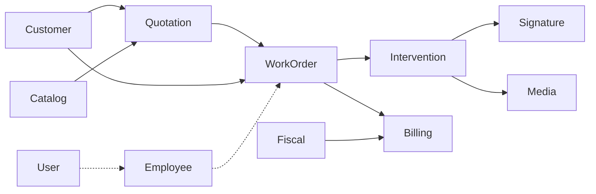

# Analisi conversione gestionale_commesse → base_workorder_fila5

> **FASE ATTUALE (2026-07-23):** [replica-singular-phase.md](./replica-singular-phase.md) — si **replicano** i moduli SRC con nome **singolare**. Le sezioni Auth↔User / AiAssistant↔AI sotto sono **gap analitici per dopo**, non istruzioni a non copiare o a cancellare repliche.

> **Perché esiste questo file:** memoria stabile del *cosa* e del *perché* del porting.  
> **Roadmap operativa (quando/come):** [roadmap.md](./roadmap.md).

## 1. Scopo e filosofia

| Domanda | Risposta |
|---|---|
| **Cosa è SRC?** | Gestionale field-service: cliente → preventivo → **commessa** → intervento → firma/fattura (+ verticali). Path: `/var/www/_bases/gestionale_commesse`. |
| **Cosa è TARGET?** | Base Laraxot (`base_workorder_fila5`): identità, CMS/FO Themes, Employee timeclock, infrastruttura (Xot/Notify/Media…). |
| **Paradosso** | Il repo si chiama *workorder* ma **non ha** ancora il modulo dominio `WorkOrder`. `Job` = code Laravel, non commesse. |
| **Religione TARGET** | XotBase/LangBase; FO Folio+Volt (no controller web FO); 1 model = 1 `create_*`; no `RefreshDatabase`; QueueableAction; docs in `docs/` esistenti. |
| **Religione SRC** | DDD-lite `Domain/`/`Application/`/`Infrastructure/`; multi Filament Panel; Actions `execute()`; glossario EN in `docs/glossary.md`. |

**Politica di conversione:** portare la **business logic** e i use-case, non copiare la struttura cartelle SRC. Ogni pezzo deve “sembrare Laraxot”.

## 2. Metodo usato

1. Inventario 23 moduli SRC (`modules_statuses.json` + Models/Filament/Actions/Migrations).
2. Confronto con `laravel/Modules/*` (conteggi modelli, resource, widget).
3. Mapping naming (Auth→User, HR→Employee, …) e anti-falsi positivi (Job≠WorkOrder, Gdpr≠Compliance).
4. Story di dettaglio in questa cartella + docs nei moduli/temi.

Fonti quantitative: [inventory-src.md](./inventory-src.md) · tabella master: [module-mapping.md](./module-mapping.md).

## 3. Modello mentale del dominio SRC

Hub: **WorkOrder**. Tutto il resto o lo alimenta (Customer/Quotation/Catalog) o lo chiude (Intervention/Signature/Billing) o lo specializza (Compliance/verticali).

## 4. Tre esiti di mapping

| Esito | Esempi | Regola |
|---|---|---|
| **Esistente + gap** | Auth→User, HR→Employee, AiAssistant→AI | Estendere; **vietato** modulo gemello |
| **Esistente da allargare** | Documents→Media, WhatsApp/Email→Notify, Platform→Tenant/Activity/Xot | Bounded context dentro il modulo owner |
| **Nuovo modulo** | Customer, WorkOrder, Intervention, Quotation, Catalog, … | nwidart + XotBase; naming singolare salvo brand |

Dettaglio candidati: [new-modules-candidates.md](./new-modules-candidates.md).

## 5. Finding critici (alta confidenza)

### 5.1 WorkOrder assente nel TARGET

Nessun modello/commessa in `laravel/Modules`. Non riusare `Job` né `Activity`. Serve modulo nuovo `WorkOrder` (vedi [STORY-004-workorders.md](./STORY-004-workorders.md)).

### 5.2 Auth ≠ User (stesso ruolo, profondità diversa)

| SRC Auth | TARGET User |
|---|---|
| Process: approval, email-OTP, panel seed, master password | Piattaforma: team/tenant/OAuth/device/Folio |
| User in `app/Models` | User in modulo + BaseUser |
| Login controller + blade | Folio/Volt/widget |

**Portare (opt-in prodotto):** approval registration, bridge User↔Customer.  
**Non portare:** master password; controller FO.  
Dettaglio: [STORY-001-auth-vs-user.md](./STORY-001-auth-vs-user.md) · [gestionale-auth-vs-user.md](../../laravel/Modules/User/docs/gestionale-auth-vs-user.md).

### 5.3 HR ⊂ / ⊃ Employee (overlap parziale)

| SRC HR ha, Employee no | Employee ha, HR no |
|---|---|
| AbsenceRequest E2E + approve/reject | WorkHour / timeclock / widgets presenza |
| MedicalVisit, Training, Document tipizzati | Department, Position, STI Admin/Employee |
| EmployeeResource completo | — |

Widget leave/pending in Employee usano **mock** (“Mock data for demonstration”) senza tabella assenze → debito già in TARGET.  
Dettaglio: [STORY-002-hr-vs-employee.md](./STORY-002-hr-vs-employee.md) · [gestionale-hr-gap.md](../../laravel/Modules/Employee/docs/gestionale-hr-gap.md).

### 5.4 AI e canali

- AiAssistant SRC = thread + proposal eseguibili; AI TARGET = sentiment/prediction → gap strutturale ([STORY-003](./STORY-003-aiassistant-vs-ai.md)).
- WhatsApp/Email SRC = inbox; Notify = template/log → estendere Notify, non gemelli.

### 5.5 UI: panels vs Themes

SRC: N panel Filament (Admin/Operator/Customer/verticali), **zero** Themes.  
TARGET: Themes FO (Sixteen/…) + panel admin per modulo.  
Porting UX = riprogettare shell Operator/Customer su Laraxot, non copiare blade.  
Canon: [gestionale-panels-vs-themes.md](../../laravel/Themes/docs/gestionale-panels-vs-themes.md).

### 5.6 Compliance ≠ Gdpr

SRC Compliance = impianti/POS/RCEE. Gdpr = privacy. Moduli distinti.

## 6. Delta architetturale (come convertire pezzo per pezzo)

| Pezzo SRC | Equivalente Laraxot |
|---|---|
| `Infrastructure/Models/*` | `app/Models/*` extends XotBase* |
| `Application/Actions/*::execute` | `app/Actions/*` + QueueableAction dove async |
| `Domain/Actions` puri | stesso, senza framework se possibile |
| `Filament/Resources` crudi | XotBaseResource / LangBase |
| `Http/Controllers` auth FO | Folio pages + Volt/widget User |
| Migrations multiple evolve | 1 `create_*` per model + bump timestamp |
| Spatie Shield seed panel | seed ruoli allineati ai panel che apriamo |
| Enum-as-table (`WorkOrderStatus`) | decidere in architecture: enum PHP vs lookup (default preferenza TARGET: enum se chiuso) |

## 7. Cosa NON è in scope della conversione “core”

- Verticali non usati dal cliente (EnergyBroker, TimberBilling, PublicProcurement, ASD/WTS panels) → wave opzionale.
- Copia 1:1 di `parity-matrix.csv` legacy PHP admin → già risolto in SRC Filament; TARGET riparte da Actions+Resource.
- Payroll completo / cedolini (né SRC HR né Employee lo sono davvero).

## 8. Rischi

| Rischio | Mitigazione |
|---|---|
| Confondere Job e WorkOrder | Doc anti-pattern + naming story |
| Duplicare Auth/HR | Solo gap su User/Employee |
| Importare Controllers FO | Gate review + regola Folio |
| Widget Employee mock in produzione | Wave 2 AbsenceRequest P0 |
| Over-scope verticali | Wave 5 gated da decisione prodotto |
| Struttura DDD SRC nel modulo nuovo | Checklist XotBase in ogni story |

## 9. Definition of Done (analisi)

- [x] Mapping 23 moduli
- [x] Gap Auth/HR/AI/WorkOrders documentati
- [x] Candidati naming
- [x] Roadmap a wave
- [ ] Conferma naming su Discussion #8
- [ ] Architecture gate Wave 1 (schema WorkOrder/Intervention)

## 10. Indice correlato

| Doc | Ruolo |
|---|---|
| [conversion-roadmap.md](./conversion-roadmap.md) | Piano wave + criteri go/no-go |
| [module-mapping.md](./module-mapping.md) | Tabella SRC→TARGET |
| [inventory-src.md](./inventory-src.md) | Inventario modelli/grafo |
| [STORY-005-unmapped-modules-survey.md](./STORY-005-unmapped-modules-survey.md) | Survey nuovi moduli |
| Issue #7 / Discussion #8 | Tracciamento GitHub |
