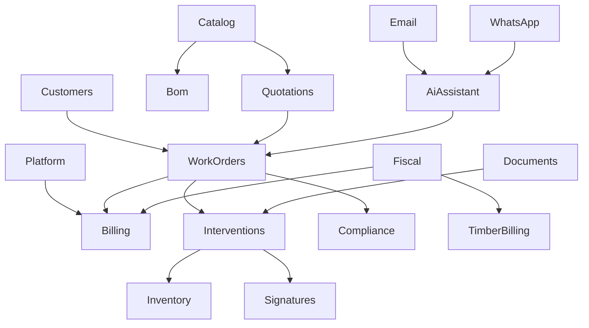

# Inventario approfondito — gestionale_commesse

> **Fonte:** `/var/www/_bases/gestionale_commesse/Modules/` (23 moduli).  
> **Stack SRC:** Laravel 12 · Filament 5 · DDD-lite (`Domain` / `Application` / `Infrastructure`).  
> **Perché:** memoria operativa per il porting — non sostituisce [module-mapping.md](./module-mapping.md).

## Dominio

Field-service **commessa-centrico**: Customer → Quotation → WorkOrder → Intervention (+ firme, magazzino, compliance) → Billing. Verticali: timber, energy broker, appalti, WTS.

## Conteggio modelli (Infrastructure/Models)

| Modulo | n | Modelli chiave |
|---|---:|---|
| PublicProcurement | 15 | Tender*, Contract, SAL, Measurement, Guarantee, AiExtraction |
| Compliance | 9 | ComplianceDocument, HeatingSystem, Boiler, Subcontractor, Readiness |
| Billing | 7 | Invoice, DeliveryNote*, Supplier*, InvoiceWorkOrderLink |
| Catalog | 7 | Product, Metel*, CatalogModel/PartType/MeasureUnit/Frequency |
| Interventions | 7 | Intervention, TimePunch, DailyNote, IssueReport, MaterialLine |
| EnergyBroker | 6 | Document, ImportBatch, SupplyPoint, SupplyHistory, CustomerMatch |
| Customers | 5 | Customer, CustomerSite, Contact, ContactRole, Reseller |
| WorkOrders | 5 | WorkOrder, Status, StatusEvent, Assignment, Activity |
| Quotations | 5 | Quotation, Item, Template*, SiteSurvey |
| HR | 5 | Employee, MedicalVisit, Training, Document, AbsenceRequest |
| Inventory | 5 | Warehouse*, Movement, ProductUnit, OverviewRow |
| AiAssistant | 4 | AiThread, AiMessage, AiActionProposal, AiToolLog |
| TimberBilling | 4 | TimberInvoice*, Installment, EInvoice |
| Email | 3 | Conversation, Message, ContactIdentity |
| WhatsApp | 3 | Conversation, Message, ContactIdentity |
| Bom | 2 | Bom, BomItem |
| Production | 2 | ProductionOrder, ProductionPhase |
| Platform | 2 | PlatformSetting, AuditLog |
| Signatures | 2 | Signature, Sketch |
| Vehicles | 2 | Vehicle, VehicleDocument |
| Documents | 1 | Media |
| Auth | 0 | User in `app/Models/User` |
| Fiscal | 0 | solo Actions/VO (IVA, FatturaPA XML) |

## Hub

| Hub | Ruolo |
|---|---|
| WorkOrders | aggregato centrale |
| Platform | settings + audit + seed demo |
| AiAssistant | orchestrazione AI cross-modulo |
| Documents | media polimorfico trasversale |

## Auth vs User (sintesi gap)

SRC Auth = **process**: approval registrazione, email-OTP post-login, `manager_id` tree, master password, seed panel verticali.  
Nostro User = **piattaforma** identità (Team/Tenant/Passport/Socialite/Folio).  
**Portare:** approval + bridge Customer (se prodotto). **Non portare:** master password. Dettaglio: [gestionale-auth-vs-user.md](../../laravel/Modules/User/docs/gestionale-auth-vs-user.md).

## HR vs Employee (sintesi gap)

SRC HR = anagrafica + visite/formazioni/documenti + AbsenceRequest approve/reject (**no** payroll/timesheet).  
Nostro Employee = WorkHour/clock + org (Department/Position) + widget leave **mock**.  
**P0:** AbsenceRequest E2E + EmployeeResource. **P1:** medical/training/docs tipizzati. Dettaglio: [gestionale-hr-gap.md](../../laravel/Modules/Employee/docs/gestionale-hr-gap.md).

## Grafo dipendenze (core)

## Integrazioni esterne SRC

OpenAI/Groq · Google Document AI · Google Calendar · Meta WhatsApp Cloud · provider FE HTTP · METEL · VIES/OpenCorporates.
