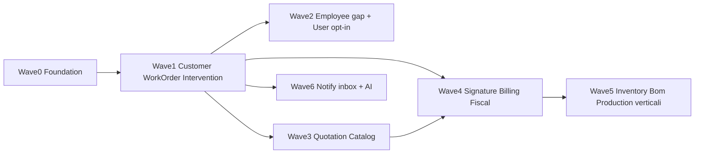

# Roadmap conversione gestionale_commesse → base_workorder_fila5

> **Analisi:** [analysis.md](./analysis.md).  
> **Obiettivo:** portare il dominio operativo SRC nella nostra versione Laraxot — wave ordinate, DoD chiari, playbook ripetibile. Solo pianificazione (nessun codice in questo file).

## 0. Principio di conversione

| SRC fa | Noi facciamo |
|---|---|
| DDD Domain/Application/Infrastructure | `app/` Laraxot + **QueueableAction** |
| Controllers + blade auth | Folio + Volt + widget User |
| `extends Resource` Filament | **XotBaseResource** / LangBase |
| Plurals moduli (`Customers`) | Singolare (`Customer`), salvo brand verticali |
| Multi-panel in `app/Providers` | Panel per modulo + Themes FO |
| User in `App\Models` | User/Employee owner nei moduli |

Ogni modulo nuovo: `module.json` + `composer.json` + 1 model = 1 create migration + factory + seeder + docs dual README.

## 1. Wave di implementazione

Ordine = dipendenze tecniche + valore business.

**Wave 0 (prima del codice):** conferma naming su Discussion [#8](https://github.com/laraxot/base_workorder_fila5/discussions/8); opzionale `bmad-architecture` su stati WorkOrder/Intervention; shard epic Wave 1 con Owned File/Module Scope.

### Wave 1 — Cuore commessa (blocca il resto)

| Deliverable | Scope minimo | Dipende da |
|---|---|---|
| Modulo `Customer` | Customer, CustomerSite, Contact, ContactRole, Reseller | User (membership opz.) |
| Modulo `WorkOrder` | WorkOrder, Status, StatusEvent, Assignment, Activity | Customer |
| Modulo `Intervention` | Intervention, TimePunch, DailyNote, IssueReport, MaterialLine | WorkOrder, Media |

**DoD wave 1**

- [ ] Moduli nwidart installati, PHPStan L10 green sul path modulo
- [ ] Resource Filament XotBase list/create/edit base
- [ ] Docs `docs/README.md` + root README per ogni modulo
- [ ] Story BMAD 1.2–1.4 chiuse o handoff ready-for-dev
- [ ] Nessun uso di `Job` per le commesse

**Story:** [1.2](../wiki/skills/bmad-create-story/stories/1.2.customer-module.story.md) · [1.3](../wiki/skills/bmad-create-story/stories/1.3.workorder-module.story.md) · [1.4](../wiki/skills/bmad-create-story/stories/1.4.intervention-module.story.md)

### Wave 2 — Persone (HR → Employee + User)

| Deliverable | Priorità |
|---|---|
| `AbsenceRequest` model + migration + approve/reject Actions | P0 |
| `EmployeeResource` anagrafica | P0 |
| Widget leave/pending su dati reali (no mock) | P0 |
| MedicalVisit / Training / Document tipizzati | P1 |
| User: approval registrazione opt-in | P1 se prodotto |
| User: **non** master password | legge |

**DoD wave 2:** Pest su absence approve/reject; widget senza stringhe mock; PHPStan L10 Employee.

**Story:** [1.5](../wiki/skills/bmad-create-story/stories/1.5.employee-hr-gap.story.md)

### Wave 3 — Preventivo e catalogo

- `Catalog` (Product + lookup/Metel se serve al cliente)
- `Quotation` (Item, Template, SiteSurvey) → conversione in WorkOrder

**DoD:** preventivo → crea WorkOrder (Action); totali coerenti.

### Wave 4 — Chiusura ciclo

- `Signature` (firma/sketch morph su Intervention)
- `Fiscal` (actions IVA / FatturaPA — zero model obbligatori)
- `Billing` (Invoice, DeliveryNote, Supplier*) usa Fiscal

**DoD:** rapportino firmabile; bozza fattura da intervento/commessa.

### Wave 5 — Manufacturing e verticali

- `Inventory`, `Bom`, `Production`
- `Compliance` (**≠ Gdpr**)
- Verticali solo se cliente: `PublicProcurement`, `EnergyBroker`, `TimberBilling`

**DoD:** feature-flag / panel solo per verticali attivi.

### Wave 6 — Canali e AI

- Estendere **Notify** (inbox WhatsApp/Email + identity → Customer/Contact)
- Estendere **AI** (AiThread, AiMessage, AiActionProposal, tool log)

**DoD:** un messaggio inbound classificabile; proposal AI confirmabile senza eseguire cieca.

## 2. Playbook — convertire un modulo SRC

Per ogni modulo in wave:

1. **Leggere** SRC: Models + Actions + Filament Resource (non i README assenti).
2. **Decidere** da [module-mapping.md](./module-mapping.md): nuovo vs estendere.
3. **Scaffold** Laraxot (nwidart) — providers solo in `module.json` / `composer.json`.
4. **Portare modelli** con naming EN glossario; fillable/cast tipizzati; soft delete se SRC li ha.
5. **Actions** → `QueueableAction` (niente Service class).
6. **Filament** → XotBaseResource / SchemaForm; label via Lang, no `->label()` hardcoded.
7. **FO** solo se serve: Folio pages nel Theme, mai Controller.
8. **Test** Pest (`.env.testing`, no RefreshDatabase).
9. **Docs** in `Modules/<Name>/docs/` (gap, business logic, link a questa roadmap).
10. **Issue/Discussion** commento con path + prove.

## 3. Dati e migrazione

| Tema | Decisione |
|---|---|
| Schema | Nuove migration XotBase sul target; **non** copiare dump SRC in cieco |
| Import legacy | Script/Action dedicata per wave (Customer poi WorkOrder) — fuori da wave codice UI |
| Stati WorkOrder | Preferire enum PHP se finiti; tabella lookup solo se editabili da BO |
| Media | Riusare `Modules\Media`; morph verso Intervention/WorkOrder |
| Tenant | Settings da Platform SRC → Tenant/Xot, non tabella sparsa |

Dati sacri: mai `migrate --force` / `migrate:fresh` in ambienti con dati.

## 4. UX / Themes

1. Panel **Admin** = risorse moduli.
2. Flussi **Operator** (timbratura, firma) = Filament pages/widgets o Folio Theme — decidere per story.
3. Login = User Folio (Sixteen/Zero), non Auth SRC.
4. Skin verticali = variant/panel id, non un Theme nuovo per verticale.

## 5. Gate BMAD prima del codice

1. Review naming Discussion [#8](https://github.com/laraxot/base_workorder_fila5/discussions/8).
2. Opzionale: `bmad-architecture` su WorkOrder/Intervention (stati, confini).
3. Story `ready-for-dev` con **Owned File/Module Scope** disgiunto (wave parallele safe).
4. `bmad-readiness-check` / handoff-manifest se multi-agente.

Story parity docs: [gestionale-commesse-module-parity.story.md](../wiki/skills/bmad-create-story/stories/gestionale-commesse-module-parity.story.md).

## 6. Metriche di avanzamento

| Metrica | Target |
|---|---|
| Wave 1 moduli merged | 3 (`Customer`, `WorkOrder`, `Intervention`) |
| Gap Employee P0 | AbsenceRequest + EmployeeResource live |
| Widget mock leave | 0 |
| Verticali | solo se flag cliente |
| PHPStan | L10 su ogni modulo nuovo |

## 7. Indice documenti

| Doc | Contenuto |
|---|---|
| [analysis.md](./analysis.md) | Analisi / findings / anti-pattern |
| [module-mapping.md](./module-mapping.md) | Tabella master 23 moduli |
| [inventory-src.md](./inventory-src.md) | Conteggio modelli + grafo |
| [new-modules-candidates.md](./new-modules-candidates.md) | Cosa creare vs estendere |
| [glossary-align.md](./glossary-align.md) | Lingua ubiqua |
| [EPIC.md](./EPIC.md) | Epic BMAD |
| [STORY-001](./STORY-001-auth-vs-user.md) … [STORY-005](./STORY-005-unmapped-modules-survey.md) | Dettaglio cluster |
| Moduli owner | User / Employee / Media / Notify / AI / Themes `docs/gestionale-*.md` |
