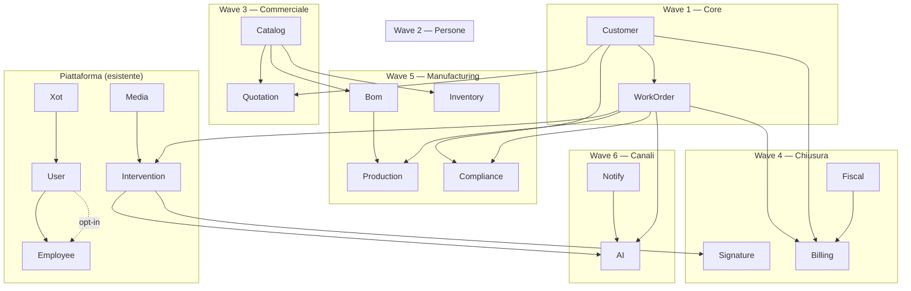

# Analisi e Roadmap: Porting gestionale_commesse → base_workorder_fila5

> **Versione:** 1.0 — 2026-07-23
> **Stato:** Analysis complete, ready for Wave 1 implementation
> **Docs di dettaglio:** `docs/gestionale-commesse-comparison/`

---

## 1. Executive Summary

Abbiamo analizzato a fondo `/var/www/_bases/gestionale_commesse` (23 moduli, ~36K file) e
confrontato con `base_workorder_fila5/laravel/Modules/` (18 moduli). **Risultato chiave:**
base_workorder_fila5 non ha ancora **nessun modulo di dominio business** — ha solo piattaforma
(Xot, User, Media, UI, Lang, ...). Il nome "base_workorder_fila5" è aspirazionale: il work order
(commessa) è completamente assente.

### Perché questa analisi

1. **Capire cosa portare**: mapping preciso di ogni modulo SRC al corrispettivo target
2. **Evitare errori**: non creare `Job` per le commesse, non confondere `Gdpr` con `Compliance`
3. **Prioritizzare**: cuore field-service prima, verticali di nicchia dopo
4. **Rispettare le convenzioni**: XotBase, Folio, naming singolare PascalCase, niente Controllers FO

### Tre categorie di esito per ogni modulo SRC

| Categoria | Quanti | Azione |
|-----------|--------|--------|
| **Rename+gap** (esistente da estendere) | 5 | Auth→User, HR→Employee, AiAssistant→AI, Documents→Media, Email/WhatsApp→Notify |
| **Split** (modulo SRC suddiviso) | 2 | Platform→Activity(Log) + Xot(Settings) |
| **Nuovo modulo** (nessun corrispettivo) | 16 | Customer, WorkOrder, Intervention, Quotation, Catalog, Billing, Fiscal, Signature, Vehicle, Inventory, Bom, Production, Compliance, PublicProcurement, EnergyBroker, TimberBilling |

---

## 2. Mapping Completo

### 2.1 Moduli SRC → Nostri (esistenti da estendere)

| SRC | Nostro | Gap da colmare | Priorità |
|-----|--------|---------------|----------|
| **Auth** | User | Registration approval (`approved_at`), `manager_id` gerarchia, email-OTP 2FA (TOTP esistente da attivare), comandi "create panel user" per verticali, seed ruoli multi-panel. **MAI** portare master password. | Wave 2 |
| **HR** | Employee | **P0:** `AbsenceRequest` E2E (model+migration+resource+policy), `EmployeeResource` CRUD, de-mock widget leave/pending. **P1:** MedicalVisit, Training, Document tipizzati. Nostro già ha WorkHour/clock + Department/Position (migrazioni mancanti). | Wave 2 |
| **AiAssistant** | AI | Thread/messaggi (`AiThread`, `AiMessage`), action proposal engine (`AiActionProposal`, `AiToolLog`), SSE chat streaming, STT/TTS, tool-calling su domain models. Predisporre ora, integrare dopo Wave 1-4. | Wave 6 |
| **Documents** | Media | Colonna `kind` (document, photo, signature, sketch), modelli `Signature`/`Sketch` morphable. Nostro già ha pipeline conversione + upload temporanei. | Wave 4 |
| **Email** / **WhatsApp** | Notify | Inbox conversazionale: messaggi/conversazioni inbound, risoluzione contatti CRM, pipeline AI processing. Nostro già ha template outbound + log. | Wave 6 |
| **Platform.AuditLog** | Activity | **Già coperto** — Activity è event-sourced, più ricco di AuditLog. Nessuna azione. | — |
| **Platform.Setting** | Xot o Tenant | Settings key-value globali. Nostri: Tenant ha `TenantSetting` (per-tenant), Xot ha `Extra` (morph). Aggiungere in Xot se serve. | Wave 5 |

### 2.2 Nuovi moduli da creare (16)

| Modulo | Da SRC | Modelli chiave | Dipende da |
|--------|--------|---------------|-----------|
| **Customer** | Customers | Customer, CustomerSite, Contact, ContactRole, Reseller | User |
| **WorkOrder** | WorkOrders | WorkOrder, WorkOrderStatus, WorkOrderAssignment, WorkOrderActivity, WorkOrderStatusEvent | Customer, User/Employee |
| **Intervention** | Interventions | Intervention, TimePunch, DailyNote, IssueReport, InterventionMaterialLine | WorkOrder, Media, Signature |
| **Quotation** | Quotations | Quotation, QuotationItem, QuotationTemplate, SiteSurvey | Customer, Catalog |
| **Catalog** | Catalog | Product, CatalogModel, MetelCatalog | — |
| **Billing** | Billing | Invoice, DeliveryNote, Supplier, InvoiceWorkOrderLink | WorkOrder, Customer, Fiscal |
| **Fiscal** | Fiscal | (solo actions/VO) — VAT calc, FatturaPA XML, payment plans. Zero modelli. | — |
| **Signature** | Signatures | Signature (morph), Sketch (morph) | Media |
| **Vehicle** | Vehicles | Vehicle, VehicleDocument | Employee |
| **Inventory** | Inventory | Warehouse, WarehouseLocation, InventoryMovement, ProductUnit | Catalog |
| **Bom** | Bom | Bom, BomItem | Catalog |
| **Production** | Production | ProductionOrder, ProductionPhase | WorkOrder, Catalog, Bom |
| **Compliance** | Compliance | HeatingSystem, Boiler, ComplianceDocument, Subcontractor, WorkOrderChangeOrder | Customer, WorkOrder |
| **PublicProcurement** | PublicProcurement | ~15 modelli (Tender, Contract, SAL, Guarantee, AiExtraction..) | WorkOrder, Customer |
| **EnergyBroker** | EnergyBroker | ~6 modelli (Document, ImportBatch, SupplyPoint, SupplyHistory..) | Customer, AI |
| **TimberBilling** | TimberBilling | TimberInvoice, TimberInvoiceLine, TimberEInvoice | Customer, Fiscal |

### 2.3 Anti-pattern: cosa NON fare

- ❌ **Creare `Job` per le commesse** — `Job` = queue Laravel, modulo esistente
- ❌ **Creare `Auth` parallelo a `User`** — portare feature in User
- ❌ **Creare `HR` parallelo a `Employee`** — colmare gap in Employee
- ❌ **Usare `Gdpr` (privacy) per Compliance impiantistica** — domini opposti
- ❌ **Route web.php per pagine** — usare Folio/Volt/Filament
- ❌ **Master password** — rischio sicurezza, non portare

---

## 3. Convenzioni di Porting

| Regola | Dettaglio |
|--------|-----------|
| **Naming moduli** | Singolare PascalCase: `WorkOrder`, `Customer`, `Intervention`. Eccezioni: brand verticali (`EnergyBroker`, `PublicProcurement`, `TimberBilling`). |
| **Naming tabelle** | `snake_case` plurale: `work_orders`, `interventions`. |
| **Naming classi** | Inglese, PascalCase, mai IT legacy. `Commessa`→`WorkOrder`, `Preventivo`→`Quotation`. |
| **Base class** | Ogni model estende `XotBaseModel`: `class WorkOrder extends XotBaseModel` |
| **No Controllers FO** | Vietati — tutto via Filament Resources/Pages + Folio/Volt |
| **No Controllers web** | Vietati — template Filament, non Blade (salvo eccezioni esplicite) |
| **No app/Interfaces** | Usare `*Contract` in `app/Contracts/` (skill `module-contracts-naming-placement`) |
| **Actions** | `Spatie\QueueableAction`, singolo `execute()`. Mai facades nelle Action. |
| **Filament** | Mai estendere `Filament\*` diretto — sempre `XotBase*` (skill `xotbase-never-extend-filament`) |
| **Struttura SRC** | SRC ha `Domain/Application/Infrastructure/`. **Non replicare** — usare struttura piatta nwidart (`app/Models`, `app/Actions`, `app/Filament`). |
| **Polimorfismo** | Usare morphTo di Eloquent per attachments/firme/sketch — non tabella centrale |
| **Stati WorkOrder** | Decisione aperta: enum PHP vs tabella lookup. Il SRC usa tabella seedata (più flessibile). |

---

## 4. Roadmap a Wave

Ordine per dipendenza: ogni wave sblocca la successiva. Dimensione: ogni wave è un epic BMAD
separato da shardare in story con `bmad-epics-and-stories`.

### Wave 1 — Cuore: Customer → WorkOrder → Intervention

| Story | Modulo | Modelli | Dipende da | Sforzo stimato |
|-------|--------|---------|-----------|---------------|
| 1.1 | Customer | Customer, CustomerSite, Contact, ContactRole, Reseller | User | Medio |
| 1.2 | WorkOrder | WorkOrder, Status, Assignment, Activity, StatusEvent | Customer, User | Alto |
| 1.3 | Intervention | Intervention, TimePunch, DailyNote, IssueReport | WorkOrder, Media | Alto |

**Perché prima:** sblocca Media morph, Signature (firme su intervento), Billing (pre-fattura da WO).
Senza Customer+WorkOrder nessun altro modulo ha aggregate root.

**Dettaglio SRC:**
- `Customers/`: 5 modelli, migration `customers`, `customer_sites`, `contacts`, `contact_roles`, `resellers`
- `WorkOrders/`: 5 modelli, 5 tabelle, macchina a stati soft (tabella lookup + action con audit trail)
- `Interventions/`: 7 modelli, timbrature (`time_punches`), note giornaliere, segnalazioni, materiali

### Wave 2 — Persone: Employee gap + User opt-in

| Story | Modulo | Cosa | Dipende da | Sforzo |
|-------|--------|------|-----------|--------|
| 2.1 | Employee | `AbsenceRequest` E2E (model, migration, Resource, Policy) | User | Alto |
| 2.2 | Employee | `EmployeeResource` CRUD (oggi manca) | User | Medio |
| 2.3 | User | Registration approval opt-in (`approved_at`) | — | Basso |
| 2.4 | Employee | MedicalVisit, Training, Document tipizzati (P1) | Employee, Media | Medio |
| 2.5 | User | Attivare/completare 2FA TOTP esistente | — | Medio |

**Perché ora:** operatori e cartellino coerenti prima di assegnare tecnici alle commesse.

### Wave 3 — Ciclo commerciale a monte

| Story | Modulo | Modelli | Dipende da |
|-------|--------|---------|-----------|
| 3.1 | Catalog | Product, CatalogModel, PartType, MeasureUnit, Frequency, Metel* | — |
| 3.2 | Quotation | Quotation, QuotationItem, QuotationTemplate, SiteSurvey | Customer, Catalog |

### Wave 4 — Chiusura ciclo commerciale

| Story | Modulo | Modelli | Dipende da |
|-------|--------|---------|-----------|
| 4.1 | Signature | Signature (morph), Sketch (morph) | Media |
| 4.2 | Billing | Invoice, DeliveryNote, Supplier, SupplierInvoice | WorkOrder, Customer, Fiscal |
| 4.3 | Fiscal | Solo actions: VAT calc, FatturaPA XML, payment plans | — |
| 4.4 | Vehicle | Vehicle, VehicleDocument | — |
| 4.5 | Media | Aggiungere `kind` column + Signature/Sketch models | — |

### Wave 5 — Manufacturing e verticali

| Story | Modulo | Modelli | Dipende da |
|-------|--------|---------|-----------|
| 5.1 | Inventory | Warehouse, WarehouseLocation, InventoryMovement, ProductUnit | Catalog |
| 5.2 | Bom | Bom, BomItem | Catalog |
| 5.3 | Production | ProductionOrder, ProductionPhase | WorkOrder, Catalog, Bom |
| 5.4 | Compliance | HeatingSystem, Boiler, ComplianceDocument, Subcontractor | Customer, WorkOrder |
| 5.5 | PublicProcurement | ~15 modelli tender-to-contract | WorkOrder, Customer |
| 5.6 | EnergyBroker | Document, ImportBatch, SupplyPoint, SupplyHistory | Customer, AI |
| 5.7 | TimberBilling | TimberInvoice, TimberInvoiceLine + Fiscal reuse | Customer, Fiscal |
| 5.8 | Xot/Tenant | PlatformSetting global key-value (se serve) | Xot |

### Wave 6 — Canali e assistente AI

| Story | Modulo | Cosa | Dipende da | Sforzo |
|-------|--------|------|-----------|--------|
| 6.1 | Notify | Inbox email: `EmailMessage`, `EmailConversation`, identity resolve | Notify, AI | Alto |
| 6.2 | Notify | Inbox WhatsApp: `WhatsAppMessage`, `WhatsAppConversation`, Bot API | Notify, AI | Alto |
| 6.3 | AI | Modelli thread/messaggi: `AiThread`, `AiMessage` | AI | Medio |
| 6.4 | AI | Action proposal engine: `AiActionProposal`, `AiToolLog` | AI, WorkOrder, Intervention | Alto |
| 6.5 | AI | SSE streaming chat + STT/TTS | AI | Medio |

---

## 5. Grafo Dipendenze (Mermaid)

---

## 6. Riferimenti

| Doc | Contenuto |
|-----|-----------|
| `docs/gestionale-commesse-comparison/README.md` | Indice completo comparativo |
| `docs/gestionale-commesse-comparison/module-mapping.md` | Tabella master 23 moduli |
| `docs/gestionale-commesse-comparison/glossary-align.md` | Lingua ubiqua SRC ↔ target |
| `docs/gestionale-commesse-comparison/new-modules-candidates.md` | Dettaglio nuovi moduli + dipendenze |
| `docs/gestionale-commesse-comparison/inventory-src.md` | Conteggi modelli, hub, grafo dipendenze SRC |
| `docs/gestionale-commesse-comparison/ROADMAP.md` | Roadmap wave-by-wave dettagliata |
| `docs/gestionale-commesse-comparison/STORY-001-auth-vs-user.md` | Auth vs User gap analysis approfondita |
| `docs/gestionale-commesse-comparison/STORY-002-hr-vs-employee.md` | HR vs Employee gap analysis approfondita |
| `docs/gestionale-commesse-comparison/STORY-003-aiassistant-vs-ai.md` | AiAssistant vs AI gap analysis |
| `docs/gestionale-commesse-comparison/STORY-004-workorders.md` | WorkOrders: struttura SRC + proposta modulo |
| `docs/gestionale-commesse-comparison/STORY-005-unmapped-modules-survey.md` | Survey 19 moduli senza corrispettivo |
| `laravel/Modules/User/docs/gestionale-auth-vs-user.md` | Auth vs User — dettaglio tecnico (54 file SRC) |
| `laravel/Modules/Employee/docs/gestionale-hr-gap.md` | HR vs Employee — dettaglio tecnico (P0/P1) |
| `laravel/Modules/AI/docs/gestionale-ai-vs-aiassistant.md` | AI vs AiAssistant — thread/proposal gap |
| `laravel/Modules/Media/docs/gestionale-documents-vs-media.md` | Media vs Documents — kind/signature gap |
| `laravel/Modules/Notify/docs/gestionale-email-whatsapp-notify.md` | Notify vs Email+WhatsApp — inbox gap |
| `laravel/Modules/Activity/docs/gestionale-platform-activity-audit.md` | Activity vs Platform.AuditLog — già coperto |
| `laravel/Modules/Tenant/docs/gestionale-platform-settings-tenant.md` | Tenant/Xot vs Platform.Settings — gap |
| `laravel/Modules/Job/docs/gestionale-job-vs-workorder.md` | Job ≠ WorkOrder — anti-confusione |
| `laravel/Modules/Gdpr/docs/gestionale-compliance-vs-gdpr.md` | Gdpr ≠ Compliance — anti-confusione |
| `gora/` (wiki) | Wiki SSoT del repository |
