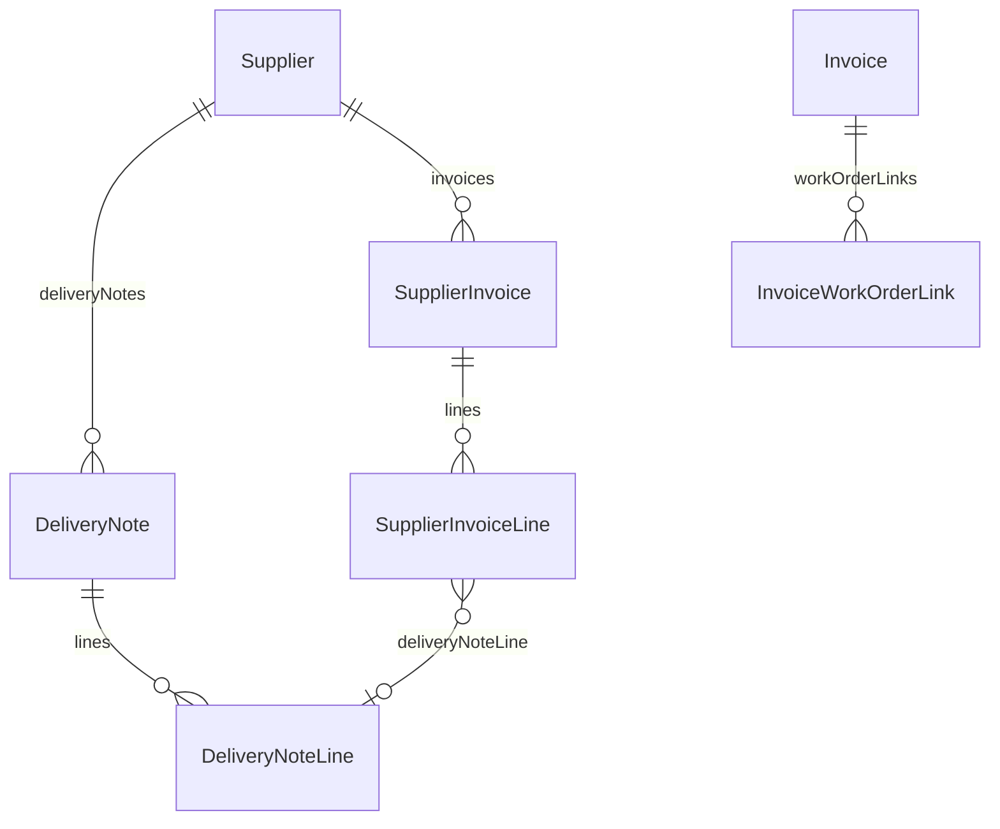

# Billing: dalla commessa chiusa alla fattura, senza ricopiare numeri

<!-- laraxot:badges:start -->
[](./)
[](https://www.php.net/)
[](https://laravel.com/)
[](https://filamentphp.com/)
[](https://livewire.laravel.com/)
[](https://phpstan.org/)
[-brightgreen?style=flat-square)](../../../docs/chat/phpstan-modules-live.json)
[](https://pestphp.com/)
[](./tests)
[](./app/Models)
[](./app/Actions)
[](./app/Filament/Resources)
[](./database/migrations)
[](./app)
[](./docs)


[](./composer.json)
[](https://github.com/nWidart/laravel-modules)
<!-- laraxot:badges:end -->

> **Pre-fattura costruita dagli interventi reali della commessa, fatture fornitore conciliate riga per riga con i DDT, scaduto clienti per fasce, cassa proiettata a 90 giorni e utile per commessa in una pagina sola.**

## In trenta secondi

Billing chiude il ciclo economico del field service. Sul lato attivo `BuildWorkOrderPreInvoiceAction` legge gli `Intervention` di un `WorkOrder` e propone le righe da fatturare (manodopera, diritto di chiamata, materiali, extra preventivo); `Invoice` conserva la fattura emessa, `GenerateInvoicePdfAction` la stampa con DomPDF e `SendElectronicInvoiceAction` la spedisce a un provider HTTP configurato nelle impostazioni piattaforma. Sul lato passivo `Supplier`, `DeliveryNote` e `SupplierInvoice` registrano fornitori, DDT e fatture ricevute, e `ReconcileSupplierInvoiceWithDeliveryNotesAction` marca ogni fattura come `reconciled` o `disputed`. La `FinancialControlPage` risponde alle tre domande del titolare: chi mi deve pagare, quando finiscono i soldi, quali commesse guadagnano davvero.

## Perché esiste

Il momento in cui si fattura è il momento in cui affiorano gli errori di tutto il ciclo: un extra preventivo mai deciso, un fornitore che fattura 14 raccordi quando il DDT ne riporta 10, una fattura scaduta da 60 giorni che nessuno ha sollecitato. Billing esiste per farli emergere prima che diventino soldi persi: la pre-fattura segnala gli extra `pending` senza metterli in totale, la conciliazione elenca le discrepanze per tipo e importo, l'aging mette il credito più vecchio in cima alla sua fascia.

## Come funziona

Ciclo attivo (fatture ai clienti):

1. `BuildWorkOrderPreInvoiceAction::execute(WorkOrder $workOrder): PreInvoiceDraft` carica `interventions()->with('materialLines')` e crea una `PreInvoiceLine` per `amount` (manodopera), `callout_fee` (diritto di chiamata) e materiali coperti dal preventivo (`line_total` meno `extra_amount`).
2. Gli extra preventivo seguono `extra_status_code`: `to_bill` diventa una riga con `sourceCode` `extra`, `pending` finisce in `pendingExtraTotal` e accende l'avviso della modale, `waived` viene ignorato.
3. `BuildPreInvoiceDraftAction::execute(array $lines, float $pendingExtraTotal = 0.0): PreInvoiceDraft` somma le righe nel `total`.
4. `Invoice` nasce dall'`InvoiceResource`; `LinkInvoiceToWorkOrderAction` e `UnlinkInvoiceFromWorkOrderAction` gestiscono `invoice_work_order_links` con `firstOrCreate` sull'indice univoco `(invoice_id, work_order_id)`.
5. Dalla pagina `ViewInvoice`: `downloadPdf` chiama `GenerateInvoicePdfAction` (vista `billing::pdf.invoice`, intestazione da `CompanyProfileProvider`), `sendElectronicInvoice` chiama `SendElectronicInvoiceAction`, che fa un `POST` JSON con bearer token e salva `electronic_invoice_provider`, `electronic_invoice_external_id`, `electronic_invoice_sent_at` oppure `electronic_invoice_last_error`.

Ciclo passivo (fornitori):

1. `Supplier` ha `deliveryNotes()` e `invoices()`; ogni `DeliveryNote` e ogni `SupplierInvoice` ha `lines()`.
2. `ReconcileSupplierInvoiceWithDeliveryNotesAction::execute(SupplierInvoice $invoice): array` raccoglie tutte le `DeliveryNoteLine` dei DDT dello stesso `supplier_id`, le passa a `ReconcileSupplierInvoiceAction` (tolleranza `EPSILON = 0.01`) e scrive `status_code` con `forceFill`.
3. Le discrepanze hanno quattro tipi in `ReconciliationDiscrepancy`: `not_delivered`, `quantity_over`, `price_mismatch`, `not_invoiced`. Solo l'ultimo lascia la fattura `reconciled`: merce consegnata e non ancora fatturata arriverà su una fattura successiva.

Controllo di gestione (`FinancialControlPage`):

- `GetReceivablesAgingQuery` legge le `invoices` con residuo positivo e `paid_on` nullo; `BuildReceivablesAgingAction` le divide nelle fasce `not_due`, `days_1_30`, `days_31_60`, `days_61_90`, `over_90`, oldest first dentro ogni fascia.
- `GetCashFlowProjectionQuery` proietta `invoices` (entrate) e `supplier_invoices` (uscite) da oggi a +90 giorni con `ProjectCashFlowAction`; lo scaduto va sul primo giorno dell'orizzonte, ciò che scade oltre resta fuori, `firstShortfallOn()` dice quando il saldo scende sotto zero.
- `GetJobMarginsQuery` prende i ricavi dagli `interventions`, la manodopera da `work_minutes` per il costo orario aziendale, i materiali dalle `delivery_note_lines` dei DDT legati alla commessa; `CalculateJobMarginAction` produce un `JobMargin` e `worstFirst()` mette in cima le commesse in perdita.



## Il modello dati

| Modello | Tabella | Relazioni e colonne chiave | Base |
|---|---|---|---|
| `Invoice` | `invoices` | `workOrderLinks()` HasMany; `customer_id`, `work_order_id`, `number`, `issued_on`, `due_on`, `paid_on`, `total`, `paid_amount`, `electronic_invoice_*`; SoftDeletes | `XotBaseModel` |
| `InvoiceWorkOrderLink` | `invoice_work_order_links` | `invoice()` BelongsTo; unique `(invoice_id, work_order_id)` | `XotBaseModel` |
| `Supplier` | `suppliers` | `deliveryNotes()`, `invoices()` HasMany; `legal_name`, `vat_number`, `is_active`; SoftDeletes | `XotBaseModel` |
| `DeliveryNote` | `delivery_notes` | `supplier()` BelongsTo, `lines()` HasMany; `work_order_id` nullable, `number`, `received_on`; SoftDeletes | `XotBaseModel` |
| `DeliveryNoteLine` | `delivery_note_lines` | `deliveryNote()` BelongsTo; `description`, `quantity`, `unit_price` decimal 12,2 | `XotBaseModel` |
| `SupplierInvoice` | `supplier_invoices` | `supplier()` BelongsTo, `lines()` HasMany; `status_code` (`pending`, `reconciled`, `disputed`), `total`, `due_on`, `paid_on`, `paid_amount`; SoftDeletes | `XotBaseModel` |
| `SupplierInvoiceLine` | `supplier_invoice_lines` | `invoice()`, `deliveryNoteLine()` BelongsTo; `delivery_note_line_id` nullable | `XotBaseModel` |

Tutti i modelli hanno `$guarded = []` e `casts()` con `decimal:2` su importi e quantità. `customers` e `work_orders` non hanno una relazione Eloquent dentro Billing: `GenerateInvoicePdfAction`, `SendElectronicInvoiceAction` e le query del controllo di gestione le leggono con `DB::table`, mentre le migrazioni le vincolano con `foreignId()->constrained()`.

## Superpoteri

Actions in [app/Actions/](./app/Actions/):

| Action | Firma di `execute()` | Accodabile |
|---|---|---|
| `BuildWorkOrderPreInvoiceAction` | `(WorkOrder $workOrder): PreInvoiceDraft` | sì |
| `BuildPreInvoiceDraftAction` | `(array $lines, float $pendingExtraTotal = 0.0): PreInvoiceDraft` | sì |
| `LinkInvoiceToWorkOrderAction` | `(Invoice $invoice, int $workOrderId): InvoiceWorkOrderLink` | sì |
| `UnlinkInvoiceFromWorkOrderAction` | `(Invoice $invoice, int $workOrderId): void` | sì |
| `GenerateInvoicePdfAction` | `(Invoice $invoice): string` (binario PDF) | sì |
| `SendElectronicInvoiceAction` | `(Invoice $invoice): array{provider, status, external_id}` | sì |
| `ReconcileSupplierInvoiceAction` | `(array $invoiceLines, array $deliveryLines): array` di `ReconciliationDiscrepancy` | sì |
| `ReconcileSupplierInvoiceWithDeliveryNotesAction` | `(SupplierInvoice $invoice): array` di `ReconciliationDiscrepancy` | sì |
| `BuildReceivablesAgingAction` | `(DateTimeImmutable $asOf, array $items): ReceivablesAging` | no, calcolo puro |
| `ProjectCashFlowAction` | `(Money $openingBalance, array $receivables, array $payables, DateTimeImmutable $from, DateTimeImmutable $to): CashFlowProjection` | no, calcolo puro |
| `CalculateJobMarginAction` | `(int $workOrderId, string $workOrderTitle, float $revenue, float $labourCost, float $materialCost, float $externalCost): JobMargin` | no, calcolo puro |

"Accodabile" significa che la classe usa `Spatie\QueueableAction\QueueableAction`: otto su undici. Le tre di calcolo non toccano il database e sono coperte da test unitari.

Query in [app/Queries/](./app/Queries/): `GetReceivablesAgingQuery`, `GetCashFlowProjectionQuery`, `GetJobMarginsQuery` fanno le letture SQL con `DB::table` e delegano il calcolo alle tre Actions pure.

DTO in [app/Datas/](./app/Datas/): 13 classi `final readonly`, tra cui `PreInvoiceDraft`, `PreInvoiceLine`, `ReconciliationDiscrepancy`, `SupplierLine`, `OpenItem`, `AgingBucket`, `ReceivablesAging`, `CashFlowEntry`, `CashFlowProjection`, `JobMargin`, `JobMarginReport`. Gli importi del controllo di gestione usano `Modules\Quotation\DTO\Money` in centesimi.

Filament in [app/Filament/](./app/Filament/):

| Elemento | Modello | Cosa fa |
|---|---|---|
| `InvoiceResource` | `Invoice` | Form con cliente e commessa a cascata, tabella con totale in EUR e data invio SDI, `WorkOrdersRelationManager` su `workOrderLinks`; nel pannello `customer/*` è in sola lettura e filtrata sul `customer_id` dell'utente |
| `ViewInvoice` | `Invoice` | Header actions `downloadPdf` e `sendElectronicInvoice` (solo in `admin/*`, con conferma e notifica di esito) |
| `SupplierResource` | `Supplier` | Ricerca globale su `legal_name`, `vat_number`, `email`, `phone`; contatori `delivery_notes_count` e `invoices_count`; filtro `is_active` |
| `DeliveryNoteResource` | `DeliveryNote` | Form con fornitore e commessa, `LinesRelationManager` con `line_total` calcolato |
| `SupplierInvoiceResource` | `SupplierInvoice` | Badge stato per gravità (`reconciled` verde, `disputed` rosso, `pending` giallo), filtri per stato e fornitore, azione `reconcileWithDeliveryNotes` con modale `billing::filament.reconciliation-result` |
| `FinancialControlPage` | nessuno | Slug `financial-control`: aging crediti, flusso di cassa con `openingBalance` inserito a mano, utile per commessa con avviso quando la tariffa oraria è quella stimata |
| `Dashboard` | nessuno | Estende `XotBaseDashboard` |

Viste in [resources/views/](./resources/views/): `filament/pre-invoice.blade.php` (modale usata dal modulo WorkOrder), `filament/reconciliation-result.blade.php`, `filament/pages/financial-control.blade.php`, `pdf/invoice.blade.php`.

Nessun comando artisan proprio: `app/Console/Commands/_components.json` è vuoto. `routes/web.php` e `routes/api.php` non dichiarano rotte: tutto passa dai pannelli Filament.

## Esempio reale

Da [tests/Feature/ReconcileSupplierInvoiceWithDeliveryNotesTest.php](./tests/Feature/ReconcileSupplierInvoiceWithDeliveryNotesTest.php):

```php
it('disputes an invoice charging more than delivered', function (): void {
    $supplier = billingSupplierWithDelivery('Raccordo', 10, 3.0);
    $invoice = billingInvoiceFor($supplier, 'Raccordo', 14, 3.0);

    $discrepancies = app(ReconcileSupplierInvoiceWithDeliveryNotesAction::class)->execute($invoice);

    expect($discrepancies)->toHaveCount(1)
        ->and($discrepancies[0]->typeCode)->toBe(ReconciliationDiscrepancy::TYPE_QUANTITY_OVER)
        ->and($discrepancies[0]->amountDifference)->toBe(12.0)
        ->and($invoice->refresh()->status_code)->toBe('disputed');
});
```

Quattro raccordi in più a 3,00 EUR l'uno: 12,00 EUR di differenza, fattura `disputed`, e la modale dice al fornitore esattamente cosa non torna.

## Numeri veri

<!-- laraxot:metrics:start -->
| Metrica | Valore | Dove guardare |
|---|---|---|
| Modelli Eloquent | 7 | `app/Models` |
| Filament resources | 4 | `app/Filament/Resources` |
| Filament pages | 2 | `app/Filament/Pages` |
| Filament widgets | 0 | `app/Filament/Widgets` |
| Queueable actions | 11 | `app/Actions` |
| Migrazioni | 7 | `database/migrations` |
| File di test | 13 | `tests` |
| File PHP in `app` | 63 | `app` |
| Righe PHP in `app` | 3.821 | `app` |
| File di traduzione | 11 | `lang` |
| Pagine di documentazione | 5 | `docs` |
| Errori PHPStan (level max, run 2026-08-31) | 0 | `docs/chat/phpstan-modules-live.json` nel progetto host |
| Commit | 1 (1 autori) | `git log` |
| Ultimo commit | 2026-09-02 (1 giorni fa) | `git log -1` |
| Repository | `laraxot/module_billing_fila5` (privata) | `git remote -v` |

Numeri misurati il 2026-09-03 con `bash bashscripts/tools/readme/module-readme-badges.sh Billing` dal progetto host. Nessun valore scritto a mano.
<!-- laraxot:metrics:end -->

## La visione

Un controllo di gestione che si aggiorna da solo ogni volta che un tecnico chiude un intervento o qualcuno registra un DDT. La fattura è l'ultimo passo di un flusso già verificato: la pre-fattura mostra cosa si sta per emettere, la conciliazione mostra cosa il fornitore chiede in più, la `FinancialControlPage` mostra se a fine periodo i soldi bastano.

## Lo scopo

- Proporre la fattura di una commessa dalle attività registrate negli `interventions`, con l'extra preventivo trattato per stato.
- Registrare fornitori, DDT e fatture fornitore e conciliarli riga per riga.
- Calcolare scaduto per fasce, cassa proiettata a 90 giorni e utile per commessa senza tabelle di appoggio.
- Produrre il PDF della fattura e inviarla a un provider di fatturazione elettronica configurabile.

## Politica

- Un extra preventivo entra in fattura solo se `extra_status_code` è `to_bill`; `pending` resta fuori dal totale ma viene mostrato per primo nella modale; `waived` è un regalo consapevole e sparisce.
- La conciliazione confronta solo i DDT dello stesso `supplier_id`; una discrepanza `not_invoiced` non contesta la fattura, tutte le altre la portano a `disputed`.
- `LinkInvoiceToWorkOrderAction` è idempotente: due chiamate uguali producono un solo record, come verifica `InvoiceWorkOrderLinkingTest`.
- `SendElectronicInvoiceAction` lancia `RuntimeException` se provider, API key o endpoint mancano; su errore HTTP salva `electronic_invoice_last_error` e rilancia, mai un fallimento silenzioso.
- L'utile per commessa non inventa il costo dei terzisti: `externalCost` resta zero finché lo schema non attribuisce le fatture fornitore a una commessa.
- Nel pannello cliente `InvoiceResource` nasconde creazione e modifica e mostra solo le fatture del `customer_id` dell'utente loggato.
- L'accesso passa da `AccountFeatures`: `admin.billing` per le risorse, `admin.financial_control` e `operator.financial_control` per la pagina di controllo.

## Religione

- Modelli su `Modules\Xot\Models\XotBaseModel`; migrazioni su `XotBaseMigration` con `tableCreate` e `tableUpdate` che aggiungono colonne solo dopo `hasColumn`.
- Risorse su `GatedXotBaseResource` e pagina su `GatedXotBasePage` del modulo Platform, che estendono `XotBaseResource` e `XotBasePage`.
- `BillingServiceProvider` estende `XotBaseServiceProvider` e registra `InvoicePolicy` (permessi `ViewAny:Invoice`, `Create:Invoice`, `Update:Invoice` e affini); `AdminPanelProvider` estende `XotBasePanelProvider`; `RouteServiceProvider` ed `EventServiceProvider` estendono le rispettive basi Xot.
- Logica in Actions Spatie con `execute()` come unico punto d'ingresso; i tre calcoli finanziari sono classi pure senza persistenza.
- DTO `final readonly` in `app/Datas/`, nessuna cartella `Services`, struttura piatta nwidart.

## Filosofia

Fatturare bene significa aver lavorato bene a monte. Billing non aggiunge controlli alla fine: rende visibile la qualità dei dati che riceve da interventi, preventivi e DDT, e chi li ha prodotti se ne accorge nella modale, non tre mesi dopo dal commercialista.

## Zen

L'extra che non decidi oggi lo regali domani.

## Configurazione

[config/config.php](./config/config.php):

| Chiave | Valore |
|---|---|
| `name` | `Billing` |
| `description` | `Fatturazione e documenti contabili` |
| `icon` | `billing-icon` |
| `navigation.enabled`, `navigation.sort` | `true`, `120` |
| `routes.middleware` | `['web', 'auth']` |

Impostazioni piattaforma lette via `Modules\Platform\Settings\SettingsRepository` (righe di `PlatformSetting`, non variabili d'ambiente):

| Chiave | Uso | Default |
|---|---|---|
| `billing.einvoice.provider` | nome del provider; `disabled` blocca l'invio | `disabled` |
| `billing.einvoice.api_key` | bearer token del `POST` | obbligatoria |
| `billing.einvoice.endpoint` | URL del provider | obbligatoria |
| `billing.einvoice.timeout_seconds` | timeout HTTP | `20` |
| `accounting.hourly_labour_cost_cents` | costo orario manodopera per l'utile commessa | `3000` (stima segnalata in pagina) |

## Quickstart

```bash
php artisan module:enable Billing
./vendor/bin/phpstan analyse Modules/Billing --memory-limit=-1
./vendor/bin/pest Modules/Billing/tests
```

Poi: crea un `Supplier`, un `DeliveryNote` con righe, una `SupplierInvoice` con le stesse righe e premi "Concilia con i DDT". Per la pre-fattura apri una commessa nel modulo WorkOrder: l'azione `preInvoice` di `WorkOrderResource` chiama `BuildWorkOrderPreInvoiceAction` e renderizza `billing::filament.pre-invoice`. Le migrazioni stanno in [database/migrations/](./database/migrations/), i seeder e le factory dei sette modelli in [database/](./database/).

## Documentazione

<!-- laraxot:docs:start -->
| Cosa | Dove |
|---|---|
| Presentazione | questo file, `README.md` |
| Indice tecnico | [docs/README.md](./docs/README.md) |
| Pacchetto Composer | `laraxot/module_billing_fila5` |
<!-- laraxot:docs:end -->

Testi umani in [lang/it/](./lang/it/): `billing.php` (fatture e pre-fattura), `suppliers.php` (fornitori, DDT, conciliazione), `management_accounting.php` (controllo di gestione). Test in [tests/](./tests/): 9 file Feature e 5 Unit.

## Ecosistema

Dipendenze da `composer.json`: `barryvdh/laravel-dompdf` per il PDF, `spatie/laravel-queueable-action` per le Actions. Repository path dichiarati: Xot, User, Tenant, UI, Customer, WorkOrder, Intervention, Platform.

Moduli letti dal codice: `WorkOrder` e `Intervention` (pre-fattura), `Quotation` (`DTO\Money`), `Platform` (`SettingsRepository`, `CompanyProfileProvider`, `GatedXotBaseResource`, `GatedXotBasePage`), `User` (`customer_id` nel pannello cliente).

Moduli che consumano Billing: `WorkOrder` (`WorkOrderResource::preInvoiceAction()` usa `BuildWorkOrderPreInvoiceAction`), `Platform` (`CustomerPanelProvider` espone `InvoiceResource`, `PlatformServiceProvider` e i seeder demo usano i modelli), `PublicProcurement` (`PublicProcurementPaymentCertificate::invoice()` è un BelongsTo verso `Invoice`).

---

Modulo `Billing` della famiglia **Laraxot**. Badge e numeri si rigenerano con `bash bashscripts/tools/readme/module-readme-badges.sh Billing`; il testo si cura a mano.
