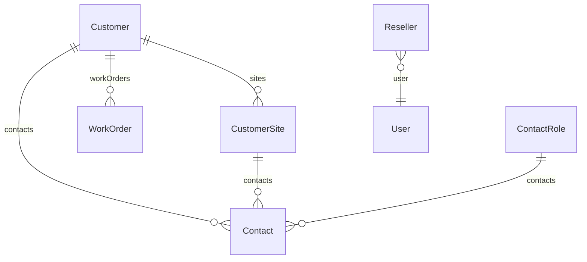

# Customer: clienti, sedi, referenti e rivenditori, con ricerca azienda online e ripristino a cascata

<!-- laraxot:badges:start -->
[](./)
[](https://www.php.net/)
[](https://laravel.com/)
[](https://filamentphp.com/)
[](https://livewire.laravel.com/)
[](https://phpstan.org/)
[-brightgreen?style=flat-square)](../../../docs/chat/phpstan-modules-live.json)
[](https://pestphp.com/)
[](./tests)
[](./app/Models)
[](./app/Actions)
[](./app/Filament/Resources)
[](./database/migrations)
[](./app)
[](./docs)


[](https://github.com/nWidart/laravel-modules)
<!-- laraxot:badges:end -->

> **Anagrafica che cerca l'azienda su VIES e Registro Imprese, tiene ogni sede in `customer_sites`, evita i referenti doppi con un upsert per email e ripristina un cliente cancellato insieme a sedi e referenti in una sola chiamata.**

## In trenta secondi

Customer è l'anagrafica commerciale di un'applicazione Laraxot: `Customer` (tabella `customers`), `CustomerSite` (`customer_sites`), `Contact` (`customer_contacts`) con `ContactRole` (`contact_roles`) e `Reseller` (`resellers`). Otto Queueable Actions in `app/Actions/` coprono creazione, aggiornamento, soft delete, ripristino a cascata, upsert dei referenti per email e ricerca aziendale online tramite `CompanyLookupProviderInterface`. Due risorse Filament, `CustomerResource` e `ResellerResource`, vivono nel pannello `customer/admin` e sono gated dalle feature account `admin.customers` e `admin.resellers`.

## Perché esiste

Il cliente è l'entità più citata da commesse, preventivi, fatture e messaggi, e la più facile da rovinare: indirizzi copiati sul cliente invece che sulla sede, referenti duplicati perché nessuno controlla l'email, cancellazioni che lasciano sedi orfane. Customer separa le responsabilità: la sede è una riga di `customer_sites` con FK `customer_id`, il referente è una riga di `customer_contacts` con `contact_role_id`, la cancellazione è soft (`deleted_at` su `customers`, `customer_sites`, `customer_contacts`, `resellers`) e il ripristino torna indietro a cascata.

## Come funziona

1. **Creazione e modifica**: `CreateCustomerAction::execute(array $data): Customer` e `UpdateCustomerAction::execute(Customer $customer, array $data): Customer` sono wrapper sottili su `Customer::query()->create()` e `fill()->save()`. La validazione (`required`, `maxLength`, `email`, `tel`) vive nel form di `CustomerResource::getFormSchema()`; le Actions non validano.
2. **Sedi**: `CreateCustomerSiteAction::execute(Customer $customer, array $data): CustomerSite` crea la sede tramite la relazione `$customer->sites()`; `SoftDeleteCustomerSiteAction` la marca cancellata.
3. **Referenti**: `UpsertCustomerContactByEmailAction` usa `Contact::updateOrCreate(['customer_id', 'email'])`; se riceve una `position` non vuota fa `ContactRole::firstOrCreate(['name' => trim($position)])` e collega il ruolo.
4. **Soft delete e ripristino**: `SoftDeleteCustomerAction` chiama solo `$customer->delete()`; nessuna cascata applicativa, la FK `cascadeOnDelete` agisce solo sul force delete. `RestoreCustomerCascadeAction` fa `restore()` sul cliente e poi su `CustomerSite` e `Contact` in `onlyTrashed()` con lo stesso `customer_id`; se il cliente non è trashed non fa nulla.
5. **Ricerca azienda online**: `SearchCompanyOnlineAction::execute(string $query): list<CompanyLookupResult>` interroga il `CompanyLookupProviderInterface` iniettato, scarta i candidati senza `legal_name`, normalizza le stringhe vuote a `null` e restituisce al massimo 5 risultati (`MAX_RESULTS`). I provider in `app/Lookup/` sono `ViesCompanyLookupProvider` (VIES REST, solo se la query contiene una partita IVA italiana di 11 cifre), `OpenApiCompanyLookupProvider` (company.openapi.com, endpoint `/IT-search` per nome e `/IT-advanced/{vat}` per partita IVA, attivo solo con `company_lookup.openapi_token`), `OpenCorporatesCompanyLookupProvider` (jurisdiction `it`) e `CompositeCompanyLookupProvider`, che restituisce il primo risultato non vuoto nell'ordine dei provider ricevuti.



## Il modello dati

| Modello | Tabella | Relazioni | Note |
|---|---|---|---|
| `Customer` | `customers` | `sites()` HasMany, `contacts()` HasMany, `workOrders()` HasMany verso `Modules\WorkOrder\Models\WorkOrder` | `SoftDeletes`, `HasXotFactory`, cast `is_active` bool, indice su `legal_name` |
| `CustomerSite` | `customer_sites` | `customer()` BelongsTo, `contacts()` HasMany | `SoftDeletes`, `HasXotFactory`, FK `customer_id` con `cascadeOnDelete` |
| `Contact` | `customer_contacts` | `customer()`, `site()` su `customer_site_id`, `role()` su `contact_role_id` | `SoftDeletes`; tabella prefissata perché `contacts` è occupata dal modulo Notify |
| `ContactRole` | `contact_roles` | `contacts()` HasMany | `name` unique, senza soft delete; `ContactRoleSeeder` inserisce Titolare, Tecnico, Amministrazione, Referente cantiere |
| `Reseller` | `resellers` | `user()` BelongsTo verso `Modules\User\Models\User` | `SoftDeletes`; `user_id` è `string(36)` per ospitare UUID, senza FK |

Tutti i modelli estendono `Modules\Customer\Models\BaseModel`, che estende `Modules\Xot\Models\XotBaseModel` e fissa `$connection = 'customer'`. Colonne di `customers`: `legal_name`, `vat_number`, `tax_code`, `email`, `phone`, `address_line1`, `address_line2`, `city`, `postal_code`, `province`, `country_code` (2 caratteri), `payment_method`, `iban`, `notes`, `is_active`.

## Superpoteri

| Cosa | Dove | Firma o comportamento |
|---|---|---|
| Crea cliente | `app/Actions/CreateCustomerAction.php` | `execute(array $data): Customer` |
| Aggiorna cliente | `app/Actions/UpdateCustomerAction.php` | `execute(Customer $customer, array $data): Customer` |
| Crea sede | `app/Actions/CreateCustomerSiteAction.php` | `execute(Customer $customer, array $data): CustomerSite` |
| Soft delete cliente | `app/Actions/SoftDeleteCustomerAction.php` | `execute(Customer $customer): void` |
| Soft delete sede | `app/Actions/SoftDeleteCustomerSiteAction.php` | `execute(CustomerSite $site): void` |
| Ripristino a cascata | `app/Actions/RestoreCustomerCascadeAction.php` | `execute(Customer $customer): void`, ripristina anche sedi e referenti |
| Upsert referente | `app/Actions/UpsertCustomerContactByEmailAction.php` | `execute(int $customerId, string $fullName, string $email, ?string $phone = null, ?string $position = null, ?string $notes = null, ?int $customerSiteId = null): Contact` |
| Ricerca azienda | `app/Actions/SearchCompanyOnlineAction.php` | `execute(string $query): list<CompanyLookupResult>` |
| Cliente simile | `app/Support/CustomerSimilarity.php` | `find(string $name, float $threshold = 80.0): ?Customer`: match esatto su `legal_name`, poi `LIKE`, poi `similar_text` sulle parole di almeno 4 lettere |
| Risorsa clienti | `app/Filament/Resources/CustomerResource.php` | ricerca globale su `legal_name`, `vat_number`, `tax_code`, `email`, `phone`, `city`; filtro `is_active`; bulk delete, restore e force delete; relation manager `WorkOrdersRelationManager`, `CustomerSitesRelationManager`, `ContactsRelationManager` |
| Scheda cliente | `app/Filament/Resources/CustomerResource/Pages/ViewCustomer.php` | azione `restoreCascade` visibile solo se il record è trashed; azione `exportCustomerReport` (PDF o DOCX su intervallo di date) che delega a `Modules\WorkOrder\Actions\GenerateCustomerReportAction` |
| Risorsa rivenditori | `app/Filament/Resources/ResellerResource.php` | campi `name`, `user_id` (select sulla relazione `user`), `notes` |
| Policy | `app/Policies/CustomerPolicy.php`, `app/Policies/ResellerPolicy.php` | permessi `ViewAny:Customer`, `Create:Customer`, `Restore:Customer`, `ForceDelete:Customer` e omologhi `:Reseller`, registrate in `CustomerServiceProvider::boot()` |

Il form cliente mostra `iban` solo quando `payment_method` vale `bonifico` e lo azzera negli altri casi (`dehydrateStateUsing`). I metodi di pagamento sono `bonifico`, `sepa`, `carta`, `contanti`, etichettati in `lang/it/customers.php`.

## Esempio reale

Da `tests/Feature/CustomerActionsTest.php`: la `position` viene trimmata prima di creare il ruolo, e una seconda chiamata con la stessa email sullo stesso cliente aggiorna il referente invece di duplicarlo.

```php
$customer = Customer::query()->create(['legal_name' => 'Acme S.p.A.', 'is_active' => 1]);

$contact = app(UpsertCustomerContactByEmailAction::class)->execute(
    customerId: $customer->id,
    fullName: 'Mario Rossi',
    email: 'mario.rossi@acme.test',
    position: ' Manager ',
);

expect($contact->contact_role_id)->not->toBeNull();
expect(ContactRole::query()->count())->toBe(1);
expect(ContactRole::query()->value('name'))->toBe('Manager');
```

## Numeri veri

<!-- laraxot:metrics:start -->
| Metrica | Valore | Dove guardare |
|---|---|---|
| Modelli Eloquent | 6 | `app/Models` |
| Filament resources | 2 | `app/Filament/Resources` |
| Filament pages | 1 | `app/Filament/Pages` |
| Filament widgets | 0 | `app/Filament/Widgets` |
| Queueable actions | 8 | `app/Actions` |
| Migrazioni | 5 | `database/migrations` |
| File di test | 14 | `tests` |
| File PHP in `app` | 41 | `app` |
| Righe PHP in `app` | 2.120 | `app` |
| File di traduzione | 7 | `lang` |
| Pagine di documentazione | 4 | `docs` |
| Errori PHPStan (level max, run 2026-08-31) | 0 | `docs/chat/phpstan-modules-live.json` nel progetto host |
| Commit | 1 (1 autori) | `git log` |
| Ultimo commit | 2026-09-02 (1 giorni fa) | `git log -1` |
| Repository | `laraxot/module_customer_fila5` (privata) | `git remote -v` |

Numeri misurati il 2026-09-03 con `bash bashscripts/tools/readme/module-readme-badges.sh Customer` dal progetto host. Nessun valore scritto a mano.
<!-- laraxot:metrics:end -->

## La visione

Un'anagrafica che gli altri moduli usano come chiave esterna e mai come campo di testo: `WorkOrder` punta a `customer_id` e `customer_site_id`, `Quotation` risolve il cliente con `CustomerSimilarity::find()` prima di crearne uno nuovo, e nessuno tiene una copia locale di ragione sociale o partita IVA.

## Lo scopo

- Dare a clienti, sedi, referenti e rivenditori una tabella ciascuno, con soft delete coerente.
- Esporre Actions `execute()` tipizzate ai moduli commerciali: commesse, preventivi, fatture, messaggistica.
- Precompilare l'anagrafica da fonti pubbliche (VIES, Registro Imprese via OpenAPI, OpenCorporates) senza inventare dati: le stringhe vuote diventano `null`.
- Ripristinare un cliente cancellato per errore insieme a sedi e referenti con una sola azione.

## Politica

- Nessuna cancellazione fisica dalle risorse: `DeleteBulkAction` fa soft delete; il force delete resta un'azione separata ed esplicita.
- `SoftDeleteCustomerAction` non tocca sedi e referenti; chi vuole nasconderle deve usare `SoftDeleteCustomerSiteAction`. Il ripristino invece è sempre a cascata.
- Un referente è identificato dalla coppia `customer_id` più `email`: si scrive con `UpsertCustomerContactByEmailAction`, non con `Contact::create()`.
- Il ruolo del referente è una riga di `contact_roles` con `name` unique, creata al volo dalla `position` trimmata; posizione vuota o solo spazi non crea ruoli.
- Nel pannello `admin`, un utente con feature `admin.assigned_perimeter` vede solo i clienti con almeno una commessa assegnata a lui (`AccountFeatures::scopeAssignedCustomers`).
- Il modulo non definisce rotte (`routes/web.php` e `routes/api.php` sono vuoti) né comandi artisan: tutto passa da Filament e dalle Actions.

## Religione

- Modelli su `Modules\Customer\Models\BaseModel`, figlia di `XotBaseModel`; `Customer` e `CustomerSite` usano `HasXotFactory`.
- Risorse su `Modules\Platform\Filament\Resources\GatedXotBaseResource`, a sua volta figlia di `XotBaseResource`: un toggle di navigazione nasconde la voce e blocca l'URL diretto.
- Pagine su `XotBaseListRecords`, `XotBaseCreateRecord`, `XotBaseEditRecord`, `XotBaseViewRecord`; relation manager su `XotBaseRelationManager`; dashboard su `XotBaseDashboard`.
- Provider su `XotBaseServiceProvider`, `XotBaseRouteServiceProvider`, `XotBasePanelProvider` (pannello `customer::admin`, path `customer/admin`).
- Migrazioni su `XotBaseMigration` con `tableCreate` e `updateTimestamps(hasSoftDeletes: true)` ovunque tranne `contact_roles`.
- Business logic in Spatie `QueueableAction` con metodo `execute()`; nessuna classe `*Service`.
- Test Pest con `DatabaseTransactions` sulle connessioni `sqlite`, `xot`, `customer`; helper `customerCreate()` e `customerCreateSite()` in `tests/PestHelpers.php`.

## Filosofia

L'anagrafica è un patto con il futuro: una partita IVA verificata su VIES oggi evita una fattura sbagliata domani, una sede salvata in `customer_sites` oggi evita una commessa nel posto sbagliato, un referente cercato per email oggi evita tre "Mario Rossi" nella rubrica.

## Zen

Un cliente, molte sedi, un'email per referente, nessun doppione.

## Configurazione

`config/config.php` del modulo:

| Chiave | Valore | Uso |
|---|---|---|
| `name`, `description` | `Customer`, descrizione dell'anagrafica | identità del modulo |
| `icon` | `customer-icon` | icona nel menu |
| `navigation.enabled`, `navigation.sort` | `true`, `140` | posizione nel menu |
| `routes.enabled`, `routes.middleware` | `true`, `['web', 'auth']` | rotte, oggi vuote |

Chiavi lette con `config()` dai provider di `app/Lookup/`, con default nel codice. Il modulo non spedisce un file `company_lookup.php`: va definito dall'applicazione host.

| Chiave | Default | Usata da |
|---|---|---|
| `company_lookup.openapi_token` | nessuno, provider disattivo | `OpenApiCompanyLookupProvider` |
| `company_lookup.openapi_base_url` | `https://company.openapi.com` | `OpenApiCompanyLookupProvider` |
| `company_lookup.opencorporates_token` | nessuno, chiamata anonima | `OpenCorporatesCompanyLookupProvider` |
| `company_lookup.timeout` | `15` secondi | `OpenApiCompanyLookupProvider`, `OpenCorporatesCompanyLookupProvider` |
| `company_lookup.vies_timeout` | `8` secondi | `ViesCompanyLookupProvider` |

Feature account lette da `App\Support\AccountFeatures`: `admin.customers`, `admin.resellers`, `admin.assigned_perimeter`.

## Quickstart

```bash
php artisan module:enable Customer
./vendor/bin/phpstan analyse Modules/Customer --memory-limit=-1
./vendor/bin/pest Modules/Customer/tests
```

Per risolvere `SearchCompanyOnlineAction` dal container serve un binding di `CompanyLookupProviderInterface`: il modulo non lo registra. Nell'ecosistema lo fornisce `Modules\AiAssistant\Providers\AiAssistantServiceProvider`, che compone OpenAPI, VIES, OpenCorporates e il provider web più AI in un `CompositeCompanyLookupProvider`. In alternativa si istanzia l'Action passando un provider al costruttore, come fa `tests/Feature/SearchCompanyOnlineActionTest.php`.

## Documentazione

<!-- laraxot:docs:start -->
| Cosa | Dove |
|---|---|
| Presentazione | questo file, `README.md` |
| Indice tecnico | [docs/README.md](./docs/README.md) |
| Pacchetto Composer | `laraxot/module_customer_fila5` |
<!-- laraxot:docs:end -->

- [docs/import-status.md](./docs/import-status.md): stato del porting, checklist e test migrati.
- [docs/tests-migration.md](./docs/tests-migration.md): bootstrap dei test e vincoli sui file Feature.
- [docs/quality-roadmap.md](./docs/quality-roadmap.md): stato PHPStan, Pest e passi aperti.

## Ecosistema

Dipendenze reali (`composer.json` non dichiara `require`, i vincoli stanno negli `use`): `Xot` (classi base), `Platform` (`GatedXotBaseResource`), `User` (`Reseller::user()`), `WorkOrder` (`Customer::workOrders()`, `WorkOrdersRelationManager`, `GenerateCustomerReportAction`), più `App\Support\AccountFeatures` dell'applicazione host per il gating.

Moduli che importano `Modules\Customer\`: `WorkOrder`, `Quotation`, `Billing`, `Intervention`, `Compliance`, `PublicProcurement`, `WhatsApp`, `Email`, `Platform`, `AiAssistant`, `EnergyBroker`, `Signage`, `Timber`, `MetalWork`, `Signature`, `Document`. `AiAssistant` implementa `CompanyLookupProviderInterface` con `WebAiCompanyLookupProvider` e registra il binding composito; `Quotation` usa `CustomerSimilarity::find()` in `BuildQuotationDraftAction` e `ResolveOrCreateCustomerFromDraftAction`.

---

Modulo `Customer` della famiglia **Laraxot**. Badge e numeri si rigenerano con `bash bashscripts/tools/readme/module-readme-badges.sh Customer`; il testo si cura a mano.
