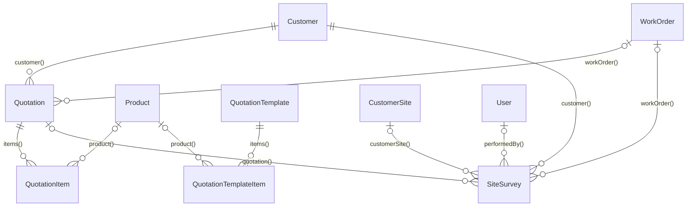

# Quotation: preventivi che nascono da rilievo, catalogo, intervento e voce

<!-- laraxot:badges:start -->
[](./)
[](https://www.php.net/)
[](https://laravel.com/)
[](https://filamentphp.com/)
[](https://livewire.laravel.com/)
[](https://phpstan.org/)
[-brightgreen?style=flat-square)](../../../docs/chat/phpstan-modules-live.json)
[](https://pestphp.com/)
[](./tests)
[](./app/Models)
[](./app/Actions)
[](./app/Filament/Resources)
[](./database/migrations)
[](./app)
[](./docs)


[](./composer.json)
[](https://github.com/nWidart/laravel-modules)
<!-- laraxot:badges:end -->

> **Un preventivo che si compone invece di scriversi: righe abbinate al catalogo da `MatchDictatedItemsToCatalogAction`, totali ricalcolati da `RecalculateQuotationTotalsAction`, dettatura a voce in `RecordQuotationVoicePage`, commessa aperta con un clic da `ViewQuotation`.**

## In trenta secondi

Quotation gestisce preventivi (`Quotation`, `QuotationItem`), modelli riusabili (`QuotationTemplate`, `QuotationTemplateItem`) e sopralluoghi (`SiteSurvey`) su una connessione dedicata `quotation` dichiarata in `BaseModel`. Venti Actions coprono il ciclo intero: bozza da dettatura o da file caricato, abbinamento delle righe ai `Product` del modulo Catalog, righe generate da un `Intervention`, applicazione di un modello, parametri tecnici che diventano righe a listino, ricalcolo dei totali in centesimi con il DTO `Money`, PDF con `QuotationPdfRenderer`, allegati riscritti in coda. Tre risorse Filament (`QuotationResource`, `QuotationTemplateResource`, `SiteSurveyResource`), la pagina vocale `RecordQuotationVoicePage` con slug `voice-quotation` e tre widget grafici per la dashboard.

## Perché esiste

Il preventivo è il primo documento che il cliente giudica e quello che in azienda si scrive con più fretta, quasi sempre ricopiando: dal sopralluogo, dal preventivo dell'anno scorso, dal rapportino del tecnico. Quotation esiste perché ogni riga arrivi da una fonte già registrata. Il rilievo `SiteSurvey` porta foto, video e note vocali nelle collection Spatie `photos`, `videos`, `voice_notes`. `CreateQuotationFromInterventionAction` legge `materialLines` e scarichi di magazzino di un intervento e li ordina come li legge un cliente: materiali, poi manodopera, poi diritto di chiamata. `BuildQuotationDraftAction` trasforma una trascrizione vocale in una `QuotationDraft` con cliente e righe. Chi decide prezzo e sconto resta una persona: tutto nasce `draft`.

## Come funziona

Il preventivo ha `status_code` con default `draft`; il form di `QuotationResource` offre `draft`, `sent`, `confirmed`, `rejected`. Il sopralluogo parte da `planned`, passa a `done` con `RecordSiteSurveyAction` (che imposta `performed_at` e salva gli allegati nella stessa transazione) e arriva a `quoted` quando il preventivo è emesso.

Flusso vocale, come lo esegue `RecordQuotationVoicePage`:

1. Il browser trascrive con `SpeechRecognition` o registra con `MediaRecorder` (componente Alpine `quotationVoice()` nella vista `record-quotation-voice.blade.php`).
2. `generateDraft()` chiama `BuildQuotationDraftAction::execute(string $transcript): QuotationDraft`, che passa dal contratto `QuotationDraftExtractorInterface` e abbina le righe con `MatchDictatedItemsToCatalogAction`. Se la dettatura dice "come quello del cliente X", `DuplicateQuotationAsDraftAction` fornisce la base e `source_quotation_id` ricorda l'origine.
3. Se la pagina ha già righe, `BuildQuotationModificationAction::execute(string $transcript, array $baseItems, ?QuotationCustomerDraft $baseCustomer)` applica solo le modifiche dettate e conserva il resto.
4. `confirm()` risolve il cliente con `ResolveOrCreateCustomerFromDraftAction` (prima per `vat_number`, poi per `legal_name`), crea il record con `CreateQuotationFromDraftAction` in transazione (`issued_at = now()`, `tax_percent` 22 se non dettata) e ricalcola i totali.
5. Con un preventivo sorgente, `QueueQuotationAttachmentRewriteAction` mette in coda `RewriteQuotationAttachmentsJob` (2 tentativi, timeout 240 s): `RewriteAndAttachQuotationDocumentsAction` copia i documenti della sorgente riscrivendo nome cliente e importi tramite `AiDocumentRewriter` su ods, odt, odp, docx, xlsx, csv e txt.

Lo stesso motore serve l'azione `importFromFile` di `ListQuotations`: `ImportQuotationFromFileAction` estrae il testo con `QuotationDocumentTextExtractor` (pdftotext per i PDF, XML per i formati Office) e lo tratta come una dettatura.



## Il modello dati

| Modello | Tabella | Colonne chiave | Relazioni | Base |
|---|---|---|---|---|
| `Quotation` | `quotations` | `customer_id`, `work_order_id`, `source_quotation_id`, `status_code`, `project`, `tax_percent`, `subtotal`, `discount_amount`, `taxable_amount`, `tax_amount`, `total`, `cost_total`, `technical_params` (json), `voice_transcript`, `voice_ai_response` (json), `issued_at`, `confirmed_at`, `delivery_at`, `lead_time_days` | `customer()`, `workOrder()`, `items()`; media `documents` | `BaseModel`, `HasMedia`, `SoftDeletes` |
| `QuotationItem` | `quotation_items` | `quotation_id`, `product_id`, `description`, `quantity`, `unit_price`, `discount_percent`, `line_total`, `sort_order` | `quotation()`, `product()` | `BaseModel` |
| `QuotationTemplate` | `quotation_templates` | `title` (unique), `notes` | `items()` | `BaseModel`, `SoftDeletes` |
| `QuotationTemplateItem` | `quotation_template_items` | `quotation_template_id`, `product_id`, stesse colonne di riga | `template()`, `product()` | `BaseModel` |
| `SiteSurvey` | `site_surveys` | `code`, `customer_id`, `customer_site_id`, `work_order_id`, `quotation_id`, `performed_by_user_id` (string 36), `status_code`, `scheduled_at`, `performed_at` | `customer()`, `customerSite()`, `workOrder()`, `quotation()`, `performedBy()`; media `photos`, `videos`, `voice_notes` | `BaseModel`, `HasMedia`, `SoftDeletes` |

`BaseModel` estende `XotBaseModel` e fissa `$connection = 'quotation'`. Tutti i modelli usano `HasXotFactory` con factory in `database/factories/`. Le cinque migrazioni estendono `XotBaseMigration`; `quotation_items.product_id` è indicizzato ma senza vincolo su `products`, per non dipendere dall'ordine di migrazione di Catalog.

## Superpoteri

Actions in [app/Actions/](./app/Actions/), tutte `final` e, tranne il calcolatore puro, con `use QueueableAction`:

| Action | Firma di `execute()` | Cosa fa |
|---|---|---|
| `CalculateQuotationTotalsAction` | `(array $items, float $taxPercent): QuotationTotals` | Somma `QuotationItemData` in `Money` (centesimi interi): subtotale, sconto, imponibile, IVA, totale, totali di riga |
| `RecalculateQuotationTotalsAction` | `(Quotation $quotation): Quotation` | Rilegge le righe per `sort_order` e persiste le sei colonne di totale |
| `ApplyQuotationTemplateToQuotationAction` | `(Quotation $quotation, QuotationTemplate $template): Quotation` | Copia le righe del modello e ricalcola |
| `ApplyTechnicalParamsToQuotationItemsAction` | `(array $items, array $params): array` | Ricalcola le righe governate dalle regole di `quotation_technical.php` sul listino corrente, lasciando intatte le righe manuali |
| `MatchDictatedItemsToCatalogAction` | `(array $items): array` | Abbina ogni `DictatedQuotationItem` a un `Product` per descrizione |
| `BuildQuotationDraftAction` | `(string $transcript): QuotationDraft` | Dalla trascrizione alla bozza con cliente, righe, IVA e note |
| `BuildQuotationModificationAction` | `(string $transcript, array $baseItems, ?QuotationCustomerDraft $baseCustomer): QuotationDraft` | Modifica a voce di una bozza esistente |
| `DuplicateQuotationAsDraftAction` | `(Quotation $source): QuotationDraft` | Preventivo esistente come base per uno simile |
| `ResolveOrCreateCustomerFromDraftAction` | `(QuotationCustomerDraft $draft): int` | Trova il cliente per partita IVA o ragione sociale, altrimenti lo crea |
| `CreateQuotationFromDraftAction` | `(QuotationDraft $draft, int $customerId): Quotation` | Persiste bozza e righe in transazione, stato `draft` |
| `BuildQuotationLinesFromInterventionAction` | `(array $materials, float $labourAmount, float $calloutFee, string $labourLabel, string $calloutLabel): array` | Righe pure: materiali, manodopera, chiamata; scarta le righe vuote |
| `CreateQuotationFromInterventionAction` | `(Intervention $intervention): ?Quotation` | Preventivo bozza dal rapportino; `null` se non c'è nulla da preventivare o manca il cliente |
| `ImportQuotationFromFileAction` | `(string $path, string $originalName): Quotation` | Da file Office, PDF o CSV a preventivo |
| `GenerateQuotationPdfAction` | `(Quotation $quotation): string` | PDF dalla vista `quotation::pdf.quotation` con dati fornitore e logo |
| `GenerateConfirmedQuotationPdfAction` | `(Quotation $quotation): string` | PDF dalla vista `quotation::pdf.confirmed-quotation` |
| `AddQuotationAttachmentAction` | `(Quotation $quotation, string $path, string $disk = 'local', int\|string\|null $uploadedByUserId = null, ?string $title = null): Media` | Allegato nella collection `documents` |
| `QueueQuotationAttachmentRewriteAction` | `(Quotation $target, string $customerName = '', int\|string\|null $userId = null): bool` | Placeholder in tabella e job in coda |
| `RewriteAndAttachQuotationDocumentsAction` | `(Quotation $source, Quotation $target, string $newCustomerName = '', int\|string\|null $userId = null): int` | Riscrive e allega i documenti della sorgente |
| `RecordSiteSurveyAction` | `(SiteSurvey $survey, array $attachments = [], ?string $notes = null): SiteSurvey` | Chiude il sopralluogo su `done` con `SiteSurveyAttachment` |
| `BackfillConfirmedAtForConfirmedQuotationsAction` | `(): int` | `confirmed_at = issued_at` dove manca sui preventivi `confirmed` |

Interfaccia Filament in [app/Filament/](./app/Filament/):

- `QuotationResource` con relation manager `ItemsRelationManager` e `AttachmentsRelationManager` (azione `reprepareAttachment`). `ViewQuotation` espone `voiceSimilar`, `downloadPdf`, `downloadConfirmedPdf`, `applyTemplate` e `createWorkOrder`, che chiama `CreateWorkOrderFromQuotationAction` e `AssignUserToWorkOrderAction` del modulo WorkOrder. `ListQuotations` espone `voiceNew` e `importFromFile`.
- `QuotationTemplateResource` con `ItemsRelationManager`.
- `SiteSurveyResource` con `AttachmentsRelationManager` e l'azione `recordSurvey` del trait `RecordsSiteSurvey`.
- [RecordQuotationVoicePage](./app/Filament/Pages/RecordQuotationVoicePage.php): fuori dalla navigazione, accessibile per feature `admin.voice_quotation` o `operator.voice_quotation`; arricchisce il cliente con `SearchCompanyOnlineAction` del modulo Customer.
- Widget in [app/Filament/Widgets/](./app/Filament/Widgets/): `QuotationsByStatusChart` (conteggio per `status_code`), `QuotationsValuePerMonthChart` (somma di `total` per mese, preventivato contro confermato), `QuotationsMarginByProjectChart` (ricavo e margine per `project` dove `cost_total > 0`, al massimo sei progetti).

Comando artisan: `php artisan quotations:backfill-confirmed-at` ([BackfillConfirmedAtCommand](./app/Console/Commands/BackfillConfirmedAtCommand.php)).

## Esempio reale

Da [tests/Unit/CalculateQuotationTotalsActionTest.php](./tests/Unit/CalculateQuotationTotalsActionTest.php):

```php
$action = new CalculateQuotationTotalsAction();
$items = [
    new QuotationItemData(quantity: 2.0, unitPrice: 10.00, discountPercent: 0.0),   // 20.00
    new QuotationItemData(quantity: 1.0, unitPrice: 100.00, discountPercent: 10.0), // 90.00
];

$totals = $action->execute($items, taxPercent: 22.0);

expect($totals->subtotal->asDecimalString())->toBe('120.00');
expect($totals->discountAmount->asDecimalString())->toBe('10.00');
expect($totals->taxableAmount->asDecimalString())->toBe('110.00');
expect($totals->taxAmount->asDecimalString())->toBe('24.20');
expect($totals->total->asDecimalString())->toBe('134.20');
```

## Numeri veri

<!-- laraxot:metrics:start -->
| Metrica | Valore | Dove guardare |
|---|---|---|
| Modelli Eloquent | 6 | `app/Models` |
| Filament resources | 3 | `app/Filament/Resources` |
| Filament pages | 2 | `app/Filament/Pages` |
| Filament widgets | 3 | `app/Filament/Widgets` |
| Queueable actions | 20 | `app/Actions` |
| Migrazioni | 5 | `database/migrations` |
| File di test | 34 | `tests` |
| File PHP in `app` | 73 | `app` |
| Righe PHP in `app` | 6.259 | `app` |
| File di traduzione | 9 | `lang` |
| Pagine di documentazione | 5 | `docs` |
| Errori PHPStan (level max, run 2026-08-31) | 0 | `docs/chat/phpstan-modules-live.json` nel progetto host |
| Commit | 2 (1 autori) | `git log` |
| Ultimo commit | 2026-09-02 (1 giorni fa) | `git log -1` |
| Repository | `laraxot/module_quotation_fila5` (privata) | `git remote -v` |

Numeri misurati il 2026-09-03 con `bash bashscripts/tools/readme/module-readme-badges.sh Quotation` dal progetto host. Nessun valore scritto a mano.
<!-- laraxot:metrics:end -->

## La visione

Un preventivo coerente con il catalogo e con quanto è stato davvero rilevato o fatto in cantiere, che il tecnico può dettare con le mani occupate e che diventa commessa senza ricopiare nulla.

## Lo scopo

- Creare preventivi da modello, da sopralluogo, da intervento, da file e da voce.
- Calcolare totali in modo deterministico con `Money` in centesimi, mai con float persistiti.
- Allegare documenti e riscriverli per un nuovo cliente fuori dalla richiesta web.
- Passare titolo, cliente e `delivery_at` alla commessa con `createWorkOrder`.

## Politica

- Ogni preventivo nasce `draft`: `CreateQuotationFromDraftAction` e `CreateQuotationFromInterventionAction` non impostano mai `sent` o `confirmed`.
- `quotations.customer_id` è obbligatorio con vincolo su `customers`; `site_surveys.quotation_id` collega il rilievo al preventivo emesso.
- Le righe governate da `quotation_technical.rules` si ricalcolano dal listino corrente per `sku`; le righe manuali non vengono toccate.
- Dagli scarichi di magazzino si prende `products.unit_price`, non il costo del movimento; il costo resta solo come ripiego per non lasciare una riga a zero.
- Manodopera e chiamata entrano come una riga ciascuna con quantità 1: dividerle in ore inventerebbe una tariffa che nessuno ha inserito.
- La riscrittura AI degli allegati valida l'XML prima di scrivere: una risposta rotta non corrompe mai il documento.
- Accesso tramite `QuotationPolicy` e `QuotationTemplatePolicy` registrate in `QuotationServiceProvider::boot()` con permessi `ViewAny:Quotation`, `Create:Quotation`, `Update:Quotation`, `Delete:Quotation`, `Restore:Quotation`, `ForceDelete:Quotation`.

## Religione

- Modelli su `XotBaseModel` tramite `BaseModel`; migrazioni su `XotBaseMigration`; factory con `HasXotFactory`.
- Risorse su `GatedXotBaseResource` e pagina vocale su `GatedXotBasePage` del modulo Platform, che estendono `XotBaseResource` e `XotBasePage`; relation manager allegati su `XotBaseRelationManager`; `Dashboard` su `XotBaseDashboard`.
- Provider su `XotBaseServiceProvider`, `XotBaseRouteServiceProvider` e `XotBasePanelProvider`.
- Logica in Actions con `execute()` e `use QueueableAction`; struttura piatta nwidart, nessun `app/Services`.
- Allegati con Spatie MediaLibrary (`HasMedia`, `InteractsWithMedia`), collection nominate per tipo.
- Contratti AI in `app/AI/` e `app/Import/`: il modulo dichiara le interfacce, non conosce il fornitore.

## Filosofia

Ciò che è stato fatto e ciò che si chiede al cliente di pagare non sono lo stesso documento, e chi decide la differenza non è chi ha scritto il rapportino. Il modulo prepara la lista; la firma resta umana.

## Zen

Rileva, componi, conferma. Non ricopiare.

## Configurazione

[config/config.php](./config/config.php): `name`, `description`, `icon` (`quotation-icon`), `navigation.enabled`, `navigation.sort` (180), `routes.middleware` (`web`, `auth`).

[config/quotation_technical.php](./config/quotation_technical.php), letto sempre come `config('quotation.quotation_technical.*')`:

| Chiave | Contenuto |
|---|---|
| `params` | Parametri tecnici salvati in `technical_params`: `surface_m2`, `flue_length_m`, `radiators_count`, `boiler_power_kw` (number con `unit`) e `thermostat_present` (bool) |
| `rules` | Regole per `product_sku` con `active_when` (`gt`, `truthy`, `falsey`) e quantità da `quantity_from` o `quantity` fissa |

Le feature `admin.voice_quotation`, `operator.voice_quotation`, `admin.dashboard` e `operator.dashboard` sono lette tramite `AccountFeatures`.

## Quickstart

```bash
php artisan module:enable Quotation
php artisan quotations:backfill-confirmed-at
./vendor/bin/phpstan analyse Modules/Quotation --memory-limit=-1
./vendor/bin/pest Modules/Quotation/tests
```

Le Actions vocali richiedono un binding per `QuotationDraftExtractorInterface` e `QuotationModificationExtractorInterface`; la riscrittura allegati per `QuotationDocumentRewriterInterface` e `QuotationNotesRewriterInterface`. Senza binding, la pagina vocale e il job non partono.

## Documentazione

<!-- laraxot:docs:start -->
| Cosa | Dove |
|---|---|
| Presentazione | questo file, `README.md` |
| Indice tecnico | [docs/README.md](./docs/README.md) |
| Pacchetto Composer | `laraxot/module_quotation_fila5` |
<!-- laraxot:docs:end -->

Pagine utili: [docs/quality-roadmap.md](./docs/quality-roadmap.md) (stato PHPStan e Pest), [docs/import-status.md](./docs/import-status.md) (migrazione dei 34 file di test), [docs/bugfix-pest-uses-import-order.md](./docs/bugfix-pest-uses-import-order.md).

## Ecosistema

Dipendenze lette dal codice: `Modules\Customer` (`Customer`, `CustomerSite`, `SearchCompanyOnlineAction`), `Modules\Catalog` (`Product`), `Modules\WorkOrder` (`WorkOrder`, `CreateWorkOrderFromQuotationAction`), `Modules\Intervention` (`Intervention`), `Modules\Inventory` (`InventoryMovement`), `Modules\User` (`User`), `Modules\Platform` (classi `Gated*`), `Modules\Xot`. Il modulo `AiAssistant` fornisce le implementazioni dei quattro contratti AI. In `composer.json` la sola dipendenza dichiarata è `php`, con repository path verso `Xot`, `User`, `Tenant`, `UI`.

Moduli che consumano Quotation: `Billing`, `Fiscal` e `Timber` usano il DTO `Money`; `Intervention` chiama `CreateQuotationFromInterventionAction`; `MetalWork` e `Signage` usano `RecalculateQuotationTotalsAction` e `QuotationResource`; `WorkOrder` e `Platform` leggono `Quotation`, `QuotationItem`, `SiteSurvey` e i widget; `AiAssistant` implementa le interfacce.

---

Modulo `Quotation` della famiglia **Laraxot**. Badge e numeri si rigenerano con `bash bashscripts/tools/readme/module-readme-badges.sh Quotation`; il testo si cura a mano.
