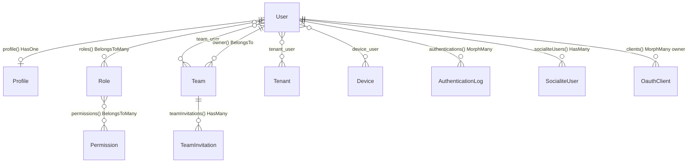

# User: chi entra, cosa può fare, da dove entra

<!-- laraxot:badges:start -->
<!-- laraxot:badges:end -->

> **Un solo `BaseUser` con UUID, STI sul campo `type`, ruoli Spatie, team, tenant, Passport, Socialite, dispositivi e log di accesso: il progetto host lo estende, non lo riscrive.**

## In trenta secondi

User è il modulo identità della famiglia Laraxot. Espone quattro classi base astratte (`BaseUser`, `BaseProfile`, `BaseTeam`, `BaseTenant`) che il progetto host estende tramite `XotData::make()->getUserClass()`, `getProfileClass()`, `getTeamClass()` e `getTenantClass()`. Sopra ci stanno ruoli e permessi (`Role` e `Permission` estendono le classi Spatie), team con inviti (`TeamInvitation`), tenant con pivot `tenant_user`, OAuth2 server con Laravel Passport (`OauthClient`, `OauthAccessToken`, `OauthRefreshToken`, `OauthAuthCode`, `OauthDeviceCode`), login social con Socialite (`SocialiteUser`, `SocialProvider`, `SsoProvider`), tracciamento dispositivi (`Device`, `DeviceUser`) e log di autenticazione (`AuthenticationLog`). Tutti i modelli usano la connessione `user`.

## Perché esiste

Ogni applicazione ha bisogno di login, ruoli e multi-tenancy, e ogni applicazione tende a reinventarli con scorciatoie diverse. User li implementa una volta sola: la tabella `users` ha `id` stringa da 36 caratteri, `is_active`, `is_otp`, `password_expires_at`, `lang` e `current_team_id`; il campo `type` alimenta la Single Table Inheritance di `Parental\HasChildren`, così il progetto host definisce i propri tipi utente (`UserType` di default: `master_admin`, `backoffice_user`, `customer_user`, `system`, `technician`) senza duplicare tabelle.

## Come funziona

1. Login: `Login` estende `XotBaseLogin`; `LoginWidget`, `SocialLoginWidget`, `RegisterWidget`, `ForgotPasswordWidget`, `ResetPasswordWidget` e `PasswordResetConfirmWidget` sono registrati come componenti Livewire da `UserServiceProvider`. La rotta `/login` in `routes/web.php` reindirizza a `/admin/login` salvo `XotData::register_pub_theme`.
2. Evento `Login`: `LoginListener` chiama `GetCurrentDeviceAction` (che usa `Jenssegers\Agent`), fa `DeviceUser::firstOrCreate` e scrive una riga in `authentication_log` tramite `authentications()->create()`. `FailedLoginListener` registra i tentativi con `login_successful = false`; `LogoutListener` e `OtherDeviceLogoutListener` chiudono il ciclo.
3. Social e SSO: `routes/socialite.php` espone `/admin/login/{provider}`, `/auth/social/{provider}` e `/sso/{provider}/callback`. `ProcessCallbackController` passa per `IsUserAllowedAction`, `AnalyzeSocialiteEmailDomainAction`, `CreateSocialiteUserAction`, `SetDefaultRolesBySocialiteUserAction` e `LoginUserAction`. `EventServiceProvider` estende Socialite con Auth0; `SocialiteServiceProvider` con Microsoft.
4. API: `PassportServiceProvider` imposta scadenze da `config/passport.php` (`access_token` 15 giorni, `refresh_token` 30 giorni, `personal_access_token` 6 mesi), abilita il password grant e registra gli scope `view-user` e `core-technicians`. `routes/api.php` espone `POST /user/login`, `GET /v2/user` e `GET /v2/logout` sotto `auth:api`.
5. Autorizzazione: `Role` ha `team_id` (permessi Spatie per team), `Permission` è il modello Spatie sulla connessione `user`; `RoleSeeder` crea `super-admin`, `admin`, `moderator`, `editor`, `user`, `guest`. `UserServiceProvider` definisce il gate `viewPulse` per `super-admin`.



## Il modello dati

| Modello | Tabella | Relazioni chiave | Base class |
|---|---|---|---|
| `BaseUser` (astratto) | `users` | `profile()`, `roles()`, `tenants()`, `devices()`, `socialiteUsers()`, `authentications()`, `clients()`, `currentTeam()`, `ownedTeams()` | `Authenticatable` + `FilamentUser`, `HasTenants`, `MustVerifyEmail`, `OAuthenticatable`, `UserContract` |
| `User` | `users` | eredita tutto da `BaseUser` | `BaseUser` |
| `BaseProfile` / `Profile` | `profiles` | `user()`, `teams()`, `devices()`, `isSuperAdmin()` | `BaseModel` (`XotBaseModel`) |
| `BaseTeam` / `Team` | `teams` | `owner()`, `users()`, `members()`, `teamUsers()`, `teamInvitations()`, `permissions()` | `BaseModel` |
| `BaseTeamUser` / `TeamUser` | `team_user` | `user()`, `team()`, cast `permissions` array | `BasePivot` |
| `TeamInvitation` | `team_invitations` | `team()`, `accepted_at`, `declined_at` | `BaseModel` |
| `BaseTenant` / `Tenant` | `tenants` | `users()`, `members()`, `slug`, `domain`, `database` | `BaseModel` + `HasSlug`, `HasMedia` |
| `TenantUser` | `tenant_user` | pivot con `tenant_id`, `user_id` | `BasePivot` |
| `Role` | `roles` | `team()`, `permissions()` | `Spatie\Permission\Models\Role` |
| `Permission` | `permissions` | modello Spatie con `HasXotFactory`, `RelationX` | `Spatie\Permission\Models\Permission` |
| `Device` | `devices` | `users()`, `mobile_id`, `platform`, `browser`, `is_mobile` | `BaseModel` |
| `AuthenticationLog` | `authentication_log` | `authenticatable()` MorphTo, `ip_address`, `login_at`, `logout_at`, `location` | `BaseModel` |
| `SocialiteUser` | `socialite_user` | `user()`, `provider`, `provider_id`, `token` | `BaseModel` |
| `SsoProvider` | `sso_providers` | `users()`, `type` (`saml`, `oidc`, `oauth`), `domain_whitelist`, `role_mapping` | `BaseModel` |
| `OauthClient` | `oauth_clients` | wrapper Passport sulla connessione `user` | `Laravel\Passport\Client` |

Le migrazioni estendono `XotBaseMigration`; `BaseUuidModel` estende `XotBaseUuidModel` e `BaseMorphPivot` estende `XotBaseMorphPivot`.

## Superpoteri

### Actions (Spatie QueueableAction, metodo `execute()`)

| Action | Firma |
|---|---|
| `app/Actions/User/CreateUserAction.php` | `execute(array $data): User` |
| `app/Actions/User/UpdateUserAction.php` | `execute(Model $user, array $data): Model` |
| `app/Actions/User/DeleteUserAction.php` | `execute(User $user, string $confirmPassword): array{success: bool, message: string}` |
| `app/Actions/User/GetNewPasswordAction.php` | `execute(UserContract $record): string` |
| `app/Actions/GetCurrentDeviceAction.php` | `execute(?string $mobileId = null): Device` |
| `app/Actions/Socialite/CreateSocialiteUserAction.php` | `execute(string $provider, SocialiteUserContract $oauthUser, UserContract $user): SocialiteUser` |
| `app/Actions/Socialite/AnalyzeSocialiteEmailDomainAction.php` | `execute(SocialiteUserContract $oauthUser, string $provider): SocialiteEmailDomainAnalysisData` |
| `app/Actions/Socialite/IsUserAllowedAction.php` | `execute(SocialiteUserContract $user): bool` |
| `app/Actions/Socialite/LoginUserAction.php` | `execute(SocialiteUser $socialiteUser): RedirectResponse` |
| `app/Actions/Socialite/SetDefaultRolesBySocialiteUserAction.php` | `execute(string $provider, UserContract $userModel, SocialiteUserContract $oauthUser): void` |
| `app/Actions/Passport/CreateClientAction.php` | `execute(string $name, string $redirect, ?UserContract $user = null, bool $personalAccess = false, bool $password = false, ?string $provider = null): OauthClient` |
| `app/Actions/Passport/RevokeAllUserTokensAction.php` | `execute(UserContract\|string $user): int` |
| `app/Actions/Passport/RegenerateClientSecretAction.php` | `execute(OauthClient\|string $client): string` |
| `app/Actions/Otp/SendOtpByUserAction.php` | `execute(UserContract $user): void` |
| `app/Actions/Otp/VerifyOtpHashAction.php` | `execute(string $value, string $hashedValue): bool` |

Le Actions in `app/Actions/Shield/` risolvono la configurazione di Filament Shield (`ResolveSuperAdminConfigurationAction`, `ResolvePermissionsConfigurationAction`) in Data object di `app/Datas/`.

### Risorse Filament (`app/Filament/Resources`, tutte su `XotBaseResource`)

`UserResource` (modello da `XotData::getUserClass()`), `ProfileResource` (via `BaseProfileResource`), `RoleResource`, `PermissionResource`, `TeamResource` (`getTeamClass()`), `TeamUserResource`, `TeamInvitationResource`, `TeamPermissionResource`, `TenantResource` (`getTenantClass()`), `TenantUserResource`, `DeviceResource`, `AuthenticationLogResource`, `PasswordResetResource`, `PersonalAccessTokenResource`, `FeatureResource`, `ClientResource` (modello da `Passport::clientModel()`), più `OauthClientResource`, `OauthAccessTokenResource`, `OauthRefreshTokenResource`, `OauthAuthCodeResource`, `OauthPersonalAccessClientResource`, `SocialiteUserResource`, `SocialProviderResource`, `SsoProviderResource`.

### Cluster, pagine e widget

| Elemento | Path | Cosa fa |
|---|---|---|
| Cluster Passport | `app/Filament/Clusters/Passport` | `PassportDashboard`, sei risorse OAuth, `PassportStatsWidget` |
| Cluster Socialite | `app/Filament/Clusters/Socialite` | risorse `SocialiteUser`, `SocialProvider`, `SsoProvider` |
| Cluster Appearance | `app/Filament/Clusters/Appearance` | pagine `Logo`, `Favicon`, `Colors`, `Background`, `Alignment`, `CustomCss` |
| `Dashboard` | `app/Filament/Pages/Dashboard.php` | `XotBaseDashboard` con `UsersChartWidget` e `RecentLoginsWidget` |
| `MyProfilePage` | `app/Filament/Pages/MyProfilePage.php` | `XotBasePage`: `name`, `email`, `current_password`, nuova password |
| `Password` | `app/Filament/Pages/Password.php` | `XotBasePage`: policy password (`min`, `expires_in`, `otp_length`, `mixedCase`, `symbols`, `uncompromised`) salvata con `SaveTenantConfigAction` del modulo Tenant |
| `SocialiteProviderSettingsPage` | `app/Filament/Pages/SocialiteProviderSettingsPage.php` | `XotBasePage`: `client_id`, `client_secret`, `scopes`, `redirect` per Google, GitHub, Microsoft, scritti in `storage/app/private/socialite-config.php` con permessi `0640` |
| Auth e Tenancy | `app/Filament/Pages/Auth`, `app/Filament/Pages/Tenancy` | `Login` (`XotBaseLogin`), `Register` (`XotBaseRegister`), `EditProfile` (`XotBaseEditProfile`), `RegisterTeam` e `RegisterTenant` (`XotBaseRegisterTenant`), `EditTeamProfile` e `EditTenantProfile` (`XotBaseEditTenantProfile`) |
| `RecentLoginsWidget` | `app/Filament/Widgets/RecentLoginsWidget.php` | `XotBaseTableWidget` su `AuthenticationLog`: `user`, `login_at`, `ip_address`, `user_agent` |
| `UsersChartWidget` | `app/Filament/Widgets/UsersChartWidget.php` | `XotBaseChartWidget` con `Flowframe\Trend` per giorno su `AuthenticationLog` |

### Comandi artisan (`app/Console/Commands`)

`user:user-list`, `user:tenant-list`, `user:team-create`, `user:tenant-create`, `user:change-password {--email=}`, `user:super-admin {email?} {--email=}`, `user:passport:install {--force}`, `passport:fetch-user-token {email}`, `user:assign-role`, `user:remove-role`, `user:assign-team`, `user:set-current-team`, `user:assign-tenant`, `user:assign-module`, `user:change-type`.

### Pagine Folio (`resources/views/pages`)

`auth/login`, `auth/register`, `auth/verify`, `auth/password/reset`, `auth/password/[token]`, `auth/password/confirm`, `profile/edit`, `dashboard/index`, `notifications/index`, `errors/password-expired`.

## Esempio reale

Da `tests/Feature/Actions/Passport/RevokeAllUserTokensActionTest.php`: l'Action accetta un `UserContract` o l'id come stringa e ritorna il numero di token revocati.

```php
$user = UserFactory::new()->createOne();

Assert::assertSame(2, DB::connection('user')->table('oauth_access_tokens')
    ->where('user_id', (string) $user->id)->where('revoked', 0)->count());

$revoked = app(RevokeAllUserTokensAction::class)->execute($user);

Assert::assertSame(2, $revoked);
Assert::assertSame(0, DB::connection('user')->table('oauth_access_tokens')
    ->where('user_id', (string) $user->id)->where('revoked', 0)->count());
```

## Numeri veri

<!-- laraxot:metrics:start -->
<!-- laraxot:metrics:end -->

## La visione

Un'identità che si estende per ereditarietà e si configura per contratto: `UserContract`, `TeamContract`, `TenantContract`, `HasAuthentications` e `HasShieldPermissions` in `app/Contracts` sono il confine; `BaseUser`, `BaseProfile`, `BaseTeam` e `BaseTenant` sono il punto di estensione; `XotData` è il registro che dice al resto dell'ecosistema quale classe concreta usare.

## Lo scopo

- Autenticare con password, OTP (`SendOtpByUserAction`, `VerifyOtpHashAction`, regola `CheckOtpExpiredRule`), social (Auth0, Google, GitHub, Microsoft) e SSO (`SsoProvider` con `domain_whitelist` e `role_mapping`).
- Autorizzare con ruoli e permessi Spatie per team, membership `team_user` con colonna `role` e pivot `tenant_user`.
- Esporre un server OAuth2 completo con Passport e amministrarlo dal cluster Filament dedicato.
- Tracciare ogni accesso in `authentication_log` e ogni dispositivo in `devices`.

## Politica

- Ogni modello legge e scrive sulla connessione `user` (`protected $connection = 'user'`): il database identità è separato da quello applicativo.
- `password` e `remember_token` sono in `$hidden` di `BaseUser`; `two_factor_secret` e `two_factor_recovery_codes` pure. Il cast `hashed` non è usato: l'hashing passa da `Hash::make` nelle Actions.
- `DeleteUserAction` richiede la password di conferma e fa `logout()` prima di `delete()`.
- La registrazione social si disattiva con `socialite.registration = false` e si restringe con `socialite.domain_allowlist`.
- `BaseUser::$with` è vuoto: i ruoli si caricano esplicitamente, non in eager load automatico.

## Religione

- `BaseModel` estende `XotBaseModel`; `BaseUuidModel` estende `XotBaseUuidModel`; `BaseMorphPivot` estende `XotBaseMorphPivot`; le migrazioni estendono `XotBaseMigration`.
- Risorse su `XotBaseResource`; pagine su `XotBasePage`, `XotBaseDashboard`, `XotBaseLogin`, `XotBaseRegister`, `XotBaseEditProfile`, `XotBaseRegisterTenant`, `XotBaseEditTenantProfile`; widget su `XotBaseSchemaWidget`, `XotBaseTableWidget`, `XotBaseChartWidget`, `XotBaseWidget`.
- `UserServiceProvider` estende `XotBaseServiceProvider`, `EventServiceProvider` estende `XotBaseEventServiceProvider`, `RouteServiceProvider` estende `XotBaseRouteServiceProvider`, `AdminPanelProvider` estende `XotBasePanelProvider`.
- Le scritture passano da Actions con `use QueueableAction` e metodo `execute()`; i dati strutturati sono Spatie Data in `app/Datas/` (`CreateUserData`, `UpdateUserData`, `PasswordData`, `SocialiteEmailDomainAnalysisData`).

## Filosofia

Le classi base sono astratte perché l'identità non appartiene a nessun progetto in particolare; il campo `type` esiste perché l'identità cambia forma senza cambiare tabella; il log di autenticazione è polimorfico (`uuidMorphs('authenticatable')`) perché non solo gli utenti fanno login.

## Zen

Il token scade, il log resta, l'utente è sempre lo stesso `id`.

## Configurazione

| File | Chiavi reali |
|---|---|
| `config/config.php` | `name`, `description`, `icon`, `navigation` |
| `config/passport.php` | `tokens.access_token` (15 giorni), `tokens.refresh_token` (30 giorni), `tokens.personal_access_token` (6 mesi), `scopes`, `enable_password_grant`, `register_routes`, `client_model`, `models` |
| `config/password.php` | `otp_expiration_minutes` (15), `otp_length` (6), `expires_in` (30 giorni), `min` (6), `mixedCase`, `letters`, `numbers`, `symbols`, `uncompromised`, `compromisedThreshold` |
| `config/socialite.php` | `domain_allowlist`, `registration`, `providers` (Auth0), `user_model`, `login_redirect_route`, `login_page_route`, `remember_login` |
| `config/services.php` | `google`, `microsoft`, `github` con `client_id`, `client_secret`, `redirect` |
| `config/social-providers.php` | catalogo di 14 provider (facebook, twitter, linkedin, google, github, gitlab, bitbucket, slack, apple, microsoft, pinterest, reddit, tiktok, twitch) |

`PassportServiceProvider` legge `user.passport.client_model` e `user.passport.models` per sostituire i modelli Passport.

## Quickstart

```bash
php artisan module:enable User
php artisan user:passport:install
php artisan user:super-admin admin@example.com
php artisan user:user-list
./vendor/bin/phpstan analyse Modules/User --memory-limit=-1
./vendor/bin/pest Modules/User/tests
```

## Documentazione

Punti di ingresso: [docs/index.md](./docs/index.md), [docs/philosophy.md](./docs/philosophy.md), [docs/social-auth-architecture.md](./docs/social-auth-architecture.md), [docs/passport-cluster-philosophy.md](./docs/passport-cluster-philosophy.md), [docs/spatie-permission-philosophy.md](./docs/spatie-permission-philosophy.md), [docs/2fa-guide.md](./docs/2fa-guide.md), [docs/api.md](./docs/api.md), [docs/coverage.md](./docs/coverage.md).

<!-- laraxot:docs:start -->
<!-- laraxot:docs:end -->

## Ecosistema

Dipendenze dichiarate in `composer.json`: `laravel/passport`, `socialiteproviders/auth0`, `socialiteproviders/microsoft`, `jenssegers/agent`, `flowframe/laravel-trend`, `spatie/laravel-personal-data-export`. Repository path verso `../Xot`, `../Tenant`, `../UI`. I provider registrati in `module.json` sono `UserServiceProvider`, `Filament\AdminPanelProvider`, `PassportServiceProvider`, `SocialiteServiceProvider`; il seeder è `RoleSeeder`.

Moduli che importano `Modules\User\` (grep sul codice, esclusa la cartella del modulo): quaranta, tra cui `Activity`, `Gdpr`, `Xot`, `Cms`, `Notify`, `Platform`, `Tenant`, `WorkOrder`, `Employee`, `HR`, `Media`, `UI`, `Lang`, `Comment`, `Billing`, `Blog`, `Email`, `Compliance`.

---

Modulo `User` della famiglia **Laraxot**. Badge e numeri si rigenerano con `bash bashscripts/tools/readme/module-readme-badges.sh User`; il testo si cura a mano.
