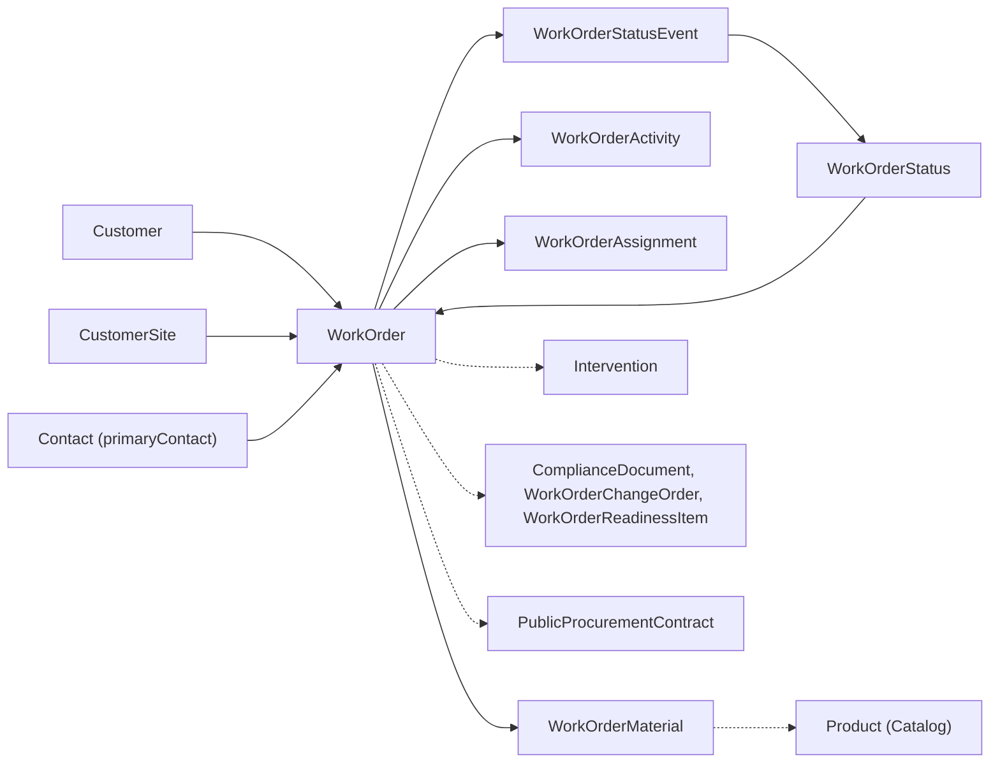

# WorkOrder: la commessa che tiene il diario dei propri stati

<!-- laraxot:badges:start -->
<!-- laraxot:badges:end -->

> **Ogni cambio di stato di una `WorkOrder` passa da `ChangeWorkOrderStatusAction` e lascia un `WorkOrderStatusEvent` con stato di partenza, stato di arrivo, utente, nota e data. Se non è in `work_order_status_events`, non è successo.**

## In trenta secondi

WorkOrder è la commessa. Il modello `WorkOrder` (tabella `work_orders`) appartiene a un `Customer`, in modo opzionale a una `CustomerSite` e a un `Contact` referente, e punta a uno stato `WorkOrderStatus` configurabile da pannello (`code`, `name`, `color`, `is_terminal`, `sort_order`). Attorno alla commessa vivono quattro figli: `WorkOrderStatusEvent` (storico delle transizioni), `WorkOrderActivity` (diario di note e cambi stato), `WorkOrderAssignment` (tecnici assegnati con ruolo) e `WorkOrderMaterial` (distinta materiali, manuale o copiata dal preventivo). Diciassette Actions Spatie `QueueableAction` coprono apertura (anche da una `Quotation`), transizioni, assegnazioni, effort previsto contro consuntivo, soft delete con ripristino a cascata e quattro export PDF. La `WorkOrderResource` Filament espone tutto in tre pannelli (`admin`, `operator`, `customer`) con visibilità diversa per ciascuno.

## Perché esiste

Interventi, materiali, ore, documenti di conformità e prefatture hanno bisogno di un contenitore con uno stato non ambiguo. Nei moduli `Intervention`, `Compliance`, `PublicProcurement`, `Billing` e `Quotation` la chiave esterna si chiama sempre `work_order_id`: questo modulo è il proprietario di quella riga. Il campo `status_id` da solo non basta, perché dice dove sei ma non come ci sei arrivato. Per questo le pagine `CreateWorkOrder` ed `EditWorkOrder` tolgono `status_id` dai dati del form e lo passano all'Action: anche lo stato iniziale finisce nello storico.

## Come funziona

1. Apertura: `CreateWorkOrderAction::execute(array $data)` oppure `CreateWorkOrderFromQuotationAction::execute(Quotation $quotation, array $overrides = [])`. La seconda, in una transazione, copia le `QuotationItem` in `work_order_materials` con `source_code = 'quotation'` ricalcolando `line_total = round(quantity * unit_price, 2)`, deriva `delivery_due_at` da `quotation.delivery_at` oppure da oggi più `lead_time_days`, intitola la commessa `Da preventivo <code>` se il preventivo non ha titolo e scrive `quotations.work_order_id`.
2. Transizione: `ChangeWorkOrderStatusAction` riceve il modello e l'id dello stato di arrivo, aggiorna `status_id`, crea il `WorkOrderStatusEvent` e, se `alsoAddActivity` resta `true`, una `WorkOrderActivity` di tipo `status` con corpo `Status changed: Open → Done`. `ChangeWorkOrderStatusByCodeAction` fa lo stesso a partire dal `code` dello stato (per esempio `in_progress`) ed è la porta usata dai moduli `Intervention` e `AiAssistant`. Nessuna delle due valida la coppia da/a: la sequenza degli stati è una scelta di chi li configura in `WorkOrderStatusResource`, non una regola nel codice.
3. Lavoro: `AssignUserToWorkOrderAction` fa `updateOrCreate` sulla coppia unica (`work_order_id`, `user_id`); `AddWorkOrderActivityAction` appende note, e la usano anche `Email` e `WhatsApp` per agganciare un messaggio alla commessa.
4. Consuntivo: `ComputeWorkOrderEffortAction` somma `interventions.work_minutes` e lo confronta con `planned_minutes` nel DTO `WorkOrderEffort` (`varianceMinutes()`, `variancePercent()`, `isOverBudget()`). In lista lo scostamento è un badge (`effort_variance`) e la colonna `delivery_due_at` diventa rossa quando la data promessa è passata e la commessa non ha né `completed_at` né `closed_at`, ambra nella settimana precedente.
5. Report: PDF della singola commessa (`pdf/work-order.blade.php`, ultime 20 attività), rendicontazione per commessa o per cliente su intervallo di date (`reports/rendicontazione.blade.php`, `reports/rendicontazione-cliente.blade.php`), resoconto periodico orizzontale dalla pagina `PeriodicSummaryPage`.
6. Cestino: `SoftDeleteWorkOrderAction` e `RestoreWorkOrderCascadeAction`, che ripristina anche le `WorkOrderActivity` cancellate e lancia `WorkOrderRestored(int $workOrderId)`; il modulo `Intervention` lo ascolta con `RestoreInterventionsForWorkOrderListener` e riporta in vita i propri interventi.



Le frecce piene sono relazioni tra modelli di questo modulo, quelle tratteggiate puntano a modelli di altri moduli dichiarati in `WorkOrder::interventions()`, `complianceDocuments()`, `changeOrders()`, `readinessItems()` e `publicProcurementContracts()`.

## Il modello dati

| Modello | Tabella | Relazioni chiave | Base |
|---|---|---|---|
| `WorkOrder` | `work_orders` | `customer()`, `site()`, `primaryContact()`, `status()`, `statusEvents()`, `activities()`, `assignments()`, `materials()` ordinata per `sort_order`, più le cinque verso altri moduli | `BaseModel`, `SoftDeletes`, `HasXotFactory` |
| `WorkOrderStatus` | `work_order_statuses` | `workOrders()` | `BaseModel` |
| `WorkOrderStatusEvent` | `work_order_status_events` | `workOrder()`, `fromStatus()`, `toStatus()`, `changedBy()` | `BaseModel` |
| `WorkOrderActivity` | `work_order_activities` | `workOrder()`, `createdBy()` | `BaseModel`, `SoftDeletes` |
| `WorkOrderAssignment` | `work_order_assignments` | `workOrder()`, `user()`, `assignedBy()` | `BaseModel` |
| `WorkOrderMaterial` | `work_order_materials` | `workOrder()`, `product()` | `BaseModel` |
| `Profile` | `profiles` | eredita tutto da `Modules\User\Models\BaseProfile` | `BaseProfile` |

`BaseModel` estende `Modules\Xot\Models\XotBaseModel` e fissa `$connection = 'work_order'`. Colonne da conoscere: `work_orders.code` è unica ma nullable; `progress_percent` è un `unsignedTinyInteger` con default 0; `planned_minutes` è nullable e, quando è nullo, l'effort non calcola alcuno scostamento. Le colonne utente (`changed_by_user_id`, `created_by_user_id`, `assigned_by_user_id`, `work_order_assignments.user_id`) sono `string(36)` per accettare UUID: lo verifica `UserIdColumnsAcceptUuidTest`. In `work_order_materials` `quantity` è `decimal(12,3)`, `unit_cost` `decimal(12,4)`, `line_total` `decimal(12,2)`, `source_code` vale `manual` o `quotation`. La migrazione `create_profiles_table` vive qui perché il modulo è il `main_module` che risolve `XotData::getProfileClass()` (vedi [docs/profile-schema-ownership.md](./docs/profile-schema-ownership.md)).

## Superpoteri

### Actions (`app/Actions`, tutte con `use QueueableAction` e metodo `execute()`)

| Action | Firma di `execute()` | Effetto |
|---|---|---|
| `CreateWorkOrderAction` | `(array $data): WorkOrder` | insert diretto in `work_orders` |
| `CreateWorkOrderFromQuotationAction` | `(Quotation $quotation, array $overrides = []): WorkOrder` | commessa più distinta materiali da preventivo, in transazione |
| `ChangeWorkOrderStatusAction` | `(WorkOrder $workOrder, int $toStatusId, int\|string\|null $changedByUserId = null, ?string $note = null, ?CarbonImmutable $changedAt = null, bool $alsoAddActivity = true): WorkOrderStatusEvent` | transizione con evento e attività |
| `ChangeWorkOrderStatusByCodeAction` | `(int $workOrderId, string $toStatusCode, int\|string\|null $changedByUserId = null, ?string $note = null): void` | transizione per codice, solo evento |
| `AssignUserToWorkOrderAction` | `(int $workOrderId, int\|string $userId, ?string $role = null, int\|string\|null $assignedByUserId = null, ?CarbonImmutable $assignedAt = null): WorkOrderAssignment` | assegnazione idempotente |
| `UnassignUserFromWorkOrderAction` | `(int $workOrderId, int\|string $userId): void` | rimuove l'assegnazione |
| `AddWorkOrderActivityAction` | `(int $workOrderId, string $type, string $body, int\|string\|null $createdByUserId = null, ?CarbonImmutable $occurredAt = null): WorkOrderActivity` | riga di diario |
| `SetWorkOrderPrimaryContactAction` | `(WorkOrder $workOrder, ?int $contactId): WorkOrder` | referente principale (usata da `Signature`) |
| `ComputeWorkOrderEffortAction` | `(WorkOrder $workOrder): WorkOrderEffort` | minuti previsti contro minuti degli interventi |
| `GenerateWorkOrderPdfAction` | `(WorkOrder $workOrder): string` | PDF della commessa via `DocumentExportBridge` |
| `GenerateWorkOrderReportAction` | `(WorkOrder $workOrder, CarbonImmutable $from, CarbonImmutable $to, string $format = 'pdf'): array{content, mime, filename}` | rendicontazione interventi della commessa |
| `GenerateCustomerReportAction` | `(Customer $customer, CarbonImmutable $from, CarbonImmutable $to, string $format = 'pdf'): array{content, mime, filename}` | rendicontazione di tutti gli interventi del cliente |
| `BuildPeriodicSummaryAction` | `(CarbonImmutable $from, CarbonImmutable $to): array` | totali, esiti, clienti, commesse, materiali, preventivi del periodo |
| `GeneratePeriodicSummaryPdfAction` | `(CarbonImmutable $from, CarbonImmutable $to): array{content, mime, filename}` | lo stesso riepilogo come PDF A4 orizzontale |
| `RestoreWorkOrderCascadeAction` | `(WorkOrder $workOrder): void` | restore di commessa e attività, evento `WorkOrderRestored` |

Completano la lista `GetWorkOrderDetailsAction(int $workOrderId): WorkOrder` (eager load di cliente, sede, referente, stato, attività, assegnazioni, eventi) e `SoftDeleteWorkOrderAction(WorkOrder $workOrder): void`. Le tre Actions di report calcolano il totale con la stessa regola: `total_amount` memorizzato sull'intervento se maggiore di zero, altrimenti manodopera più diritto di chiamata più materiali, dove i materiali sono il massimo fra movimenti di magazzino di tipo `scarico`, righe manuali e `materials_total`. Il formato `docx` è accettato dai form ma `generateDocx()` lancia `RuntimeException` finché non è installato `phpoffice/phpword`.

### Filament (`app/Filament`)

| Componente | Cosa fa |
|---|---|
| [`WorkOrderResource`](./app/Filament/Resources/WorkOrderResource.php) | estende `GatedXotBaseResource`; ricerca globale su `code`, `title`, `description`, `customer.legal_name`; filtri per cliente, sede, stato e intervallo `scheduled_at`; azioni di riga `exportReport` (PDF o DOCX su intervallo), `preInvoice` (delega a `Modules\Billing\Actions\BuildWorkOrderPreInvoiceAction`), view, edit |
| Pagine `ListWorkOrders`, `CreateWorkOrder`, `EditWorkOrder`, `ViewWorkOrder` | estendono `XotBaseListRecords`, `XotBaseCreateRecord`, `XotBaseEditRecord`, `XotBaseViewRecord`; la view ha le azioni `downloadPdf`, `exportReport`, `restoreCascade` (visibile solo se la commessa è nel cestino) |
| Nove relation manager su `XotBaseRelationManager` | `Activities`, `Assignments`, `Interventions`, `PublicProcurementContracts`, `StatusEvents` sempre; `ComplianceDocuments`, `ChangeOrders`, `ReadinessItems` solo con la feature `artisan_readiness`; `Materials` solo nel pannello `customer` |
| [`WorkOrderStatusResource`](./app/Filament/Resources/WorkOrderStatusResource.php) | anagrafica stati: `code` unico, `name`, `color` fra `gray`, `blue`, `amber`, `green`, `red`, `sort_order`, toggle `is_terminal`; solo pannello admin |
| [`PeriodicSummaryPage`](./app/Filament/Pages/PeriodicSummaryPage.php) | estende `GatedXotBasePage`, slug `periodic-summary`, preset `this_month`, `last_month`, `this_quarter`, `this_year`, metodo `downloadPdf()` |
| [`WorkOrdersStatusChart`](./app/Filament/Widgets/WorkOrdersStatusChart.php) | ciambella con i sei stati più popolati; nel pannello operatore conta solo le commesse con interventi eseguiti dall'utente |
| `Dashboard` | estende `XotBaseDashboard` |

Nel pannello `operator` la query è ristretta alle commesse assegnate (`AccountFeatures::scopeAssignedWorkOrders`), nel pannello `customer` a `customer_id` dell'utente loggato. `AdminPanelProvider` (su `XotBasePanelProvider`) registra nel pannello anche le risorse e le pagine del modulo `Intervention`. Il modulo non ha comandi artisan, route in `routes/web.php` e `routes/api.php` né pagine Folio.

## Esempio reale

Da [`tests/Feature/ChangeStatusTest.php`](./tests/Feature/ChangeStatusTest.php): una transizione da `open` a `done` scrive un evento e un'attività di tipo `status`.

```php
$event = app(ChangeWorkOrderStatusAction::class)->execute(
    workOrder: $workOrder,
    toStatusId: $doneId,
    changedByUserId: $userId,
    note: 'Completed by test',
);

$workOrder->refresh();
expect($workOrder->status_id)->toBe($doneId);
expect($event->from_status_id)->toBe($openId);
expect($event->to_status_id)->toBe($doneId);
expect(DB::table('work_order_status_events')->where('work_order_id', $workOrder->id)->count())->toBe(1);
expect(DB::table('work_order_activities')->where('work_order_id', $workOrder->id)->where('type', 'status')->count())->toBe(1);
```

Da [`tests/Feature/ComputeWorkOrderEffortTest.php`](./tests/Feature/ComputeWorkOrderEffortTest.php): 300 minuti previsti e interventi da 240 e 180 minuti danno `varianceMinutes() === 120`, `variancePercent() === 40.0` e `isOverBudget() === true`.

## Numeri veri

<!-- laraxot:metrics:start -->
<!-- laraxot:metrics:end -->

## La visione

Una commessa che racconta da sola la propria storia: chi l'ha aperta (`opened_at`, primo `WorkOrderStatusEvent`), chi ci ha lavorato (`work_order_assignments`, `interventions.performed_by_user_id`), cosa è stato usato (`work_order_materials`, movimenti di magazzino agganciati agli interventi), quando ha cambiato stato e perché (`from_status_id`, `to_status_id`, `note`). Il PDF della commessa e la rendicontazione sono letture di questa storia, non documenti compilati a parte.

## Lo scopo

- Tenere lo stato della commessa esplicito e storicizzato tramite `WorkOrderStatus` e `WorkOrderStatusEvent`.
- Assegnare tecnici e registrare attività e materiali senza obbligare ogni riga a stare a catalogo (`product_id` nullable, `description` obbligatoria).
- Confrontare `planned_minutes` con i minuti reali degli interventi e mostrare lo scostamento dove si decide, cioè in lista.
- Produrre PDF per commessa, per cliente e per periodo con un'unica regola di calcolo dei totali.

## Politica

- Lo stato cambia solo tramite `ChangeWorkOrderStatusAction` o `ChangeWorkOrderStatusByCodeAction`: le pagine Filament rimuovono `status_id` dal payload e delegano; anche `StatusEventsRelationManager` crea l'evento passando dall'Action.
- Ogni transizione porta `changed_by_user_id`, `note` e `changed_at`; l'utente può essere `null` quando la transizione arriva da un processo e non da una persona.
- `is_terminal` e `closed_at` sono informazioni, non lucchetti: il modulo non blocca interventi o transizioni su una commessa con stato finale e non valorizza `closed_at` da solo. `BuildPeriodicSummaryAction` conta `work_orders_closed` proprio su `closed_at`, quindi chi lo lascia vuoto non vedrà chiusure nel resoconto.
- Cancellare è soft: `WorkOrder` e `WorkOrderActivity` usano `SoftDeletes`; il ripristino passa da `RestoreWorkOrderCascadeAction`, che è no-op se la commessa non è nel cestino (`RestoreWorkOrderCascadeNoopTest`).
- I test estendono `Modules\Xot\Tests\XotBaseTestCase` con `DatabaseTransactions` sulle connessioni `sqlite` e `xot`: niente `RefreshDatabase`, come dichiarato in `tests/Pest.php`.

## Religione

- Modelli su `Modules\Xot\Models\XotBaseModel` tramite `BaseModel` con connessione `work_order`; `Profile` su `Modules\User\Models\BaseProfile`.
- Risorse su `Modules\Platform\Filament\Resources\GatedXotBaseResource`, che estende `XotBaseResource`; pagine su `GatedXotBasePage` (da `XotBasePage`) e `XotBaseDashboard`; relation manager su `XotBaseRelationManager`; pagine di risorsa su `XotBaseListRecords`, `XotBaseCreateRecord`, `XotBaseEditRecord`, `XotBaseViewRecord`.
- Migrazioni su `Modules\Xot\Database\Migrations\XotBaseMigration` con `tableCreate()`, `tableUpdate()` e `updateTimestamps()`.
- Provider su `XotBaseServiceProvider` (registra `Gate::policy(WorkOrder::class, WorkOrderPolicy::class)` con permessi `ViewAny:WorkOrder`, `Create:WorkOrder`, `Update:WorkOrder`, `Delete:WorkOrder`, `Restore:WorkOrder`, `ForceDelete:WorkOrder`), `XotBasePanelProvider`, `XotBaseRouteServiceProvider`.
- Logica in Actions Spatie `QueueableAction` in `app/Actions`; `app/Domain` ospita solo il DTO `WorkOrderEffort` e l'evento `WorkOrderRestored`, nessuna cartella di servizi.
- `WorkOrder` non è un `Job`: `Job` è la coda di Laravel, la commessa è `WorkOrder`.

## Filosofia

La commessa è un contratto in esecuzione. Il preventivo dice cosa si è promesso (`CreateWorkOrderFromQuotationAction` porta dentro righe e data di consegna), gli interventi dicono cosa si è fatto (`work_minutes`, materiali), lo storico dice quando si è deciso di cambiare fase. Il modulo non decide al posto dell'officina quali fasi esistano: le legge da `work_order_statuses` e si limita a pretendere che ogni passaggio lasci traccia.

## Zen

Lo stato che non sai spiegare è lo stato che non hai: chiedi a `work_order_status_events`.

## Configurazione

`config/config.php` espone `name`, `description` (`Commesse e ordini di lavoro`), `icon` (`workorder-icon`), `navigation.enabled` e `navigation.sort` (210), `routes.enabled` e `routes.middleware` (`web`, `auth`), `providers`.

A runtime il modulo legge:

| Chiave | Dove | Effetto |
|---|---|---|
| `inventory.allow_link_interventions` | `Modules\Platform\Settings\SettingsRepository`, default `true` | se `false` i report e il resoconto ignorano i movimenti di magazzino |
| `admin.work_orders`, `operator.work_orders` | `App\Support\AccountFeatures` | visibilità di `WorkOrderResource` per pannello |
| `admin.artisan_readiness`, `operator.artisan_readiness` | `AccountFeatures` | mostra i relation manager di conformità |
| `admin.reports`, `admin.periodic_summary`, `admin.dashboard`, `operator.dashboard` | `AccountFeatures` | azione `exportReport`, pagina di riepilogo, widget |
| `app.demo_mode` | `config()` | se `true` il pannello operatore non filtra per assegnazione |

Dipendenze morbide: `DocumentExportBridge::pdfFromView()` controlla `class_exists('Barryvdh\DomPDF\Facade\Pdf')` e lancia `RuntimeException` se `barryvdh/laravel-dompdf` manca; `phpoffice/phpword` servirebbe per il DOCX, oggi non implementato.

## Quickstart

```bash
php artisan module:enable WorkOrder
./vendor/bin/phpstan analyse Modules/WorkOrder --memory-limit=-1
./vendor/bin/pest Modules/WorkOrder/tests
```

Poi crea almeno uno stato in `WorkOrderStatusResource` (per esempio `code = open`), apri una commessa da `WorkOrderResource` o da una `Quotation` con `CreateWorkOrderFromQuotationAction`, e controlla che il relation manager `StatusEvents` mostri la prima transizione.

## Documentazione

<!-- laraxot:docs:start -->
<!-- laraxot:docs:end -->

Pagine tecniche interne: [docs/README.md](./docs/README.md), [docs/basemodel-connection.md](./docs/basemodel-connection.md), [docs/profile-schema-ownership.md](./docs/profile-schema-ownership.md), [docs/quality-roadmap.md](./docs/quality-roadmap.md). Traduzioni in [lang/it/work_orders.php](./lang/it/work_orders.php), [lang/it/work_order_status.php](./lang/it/work_order_status.php) e [lang/it/material.php](./lang/it/material.php).

## Ecosistema

`composer.json` richiede solo `php ^8.3` e dichiara repository di tipo path verso `Xot`, `User`, `Tenant`, `UI`. Nel codice il modulo importa `Xot`, `User`, `Platform`, `Customer` (`Customer`, `CustomerSite`, `Contact`), `Catalog` (`Product`), `Intervention` (`Intervention`, `InterventionMaterialLine`), `Inventory` (`InventoryMovement`), `Quotation` (`Quotation`, `QuotationItem`), `Compliance`, `PublicProcurement` e `Billing`.

Chi consuma `Modules\WorkOrder\*` (file PHP per modulo, escluso WorkOrder stesso): `Compliance` 13, `Intervention` 12, `Platform` 8, `WhatsApp` 7, `Quotation` 4, `Email` 4, `AiAssistant` 4, `PublicProcurement` 3, `Customer` 3, `Billing` 3, `Signature` 2, `Signage` 2, `Production` 2, `Inventory` 2. Con `Intervention`, `Compliance`, `Quotation` e `Billing` la dipendenza è in entrambe le direzioni: `WorkOrder` dichiara le relazioni, loro chiamano le Actions.

---

Modulo `WorkOrder` della famiglia **Laraxot**. Badge e numeri si rigenerano con `bash bashscripts/tools/readme/module-readme-badges.sh WorkOrder`; il testo si cura a mano.
